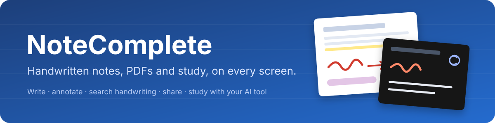
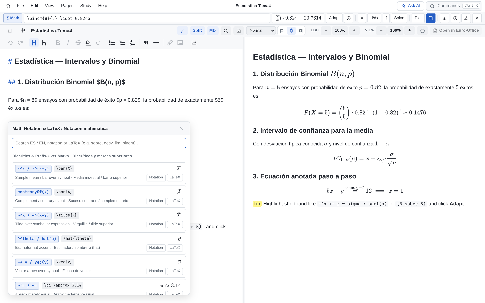
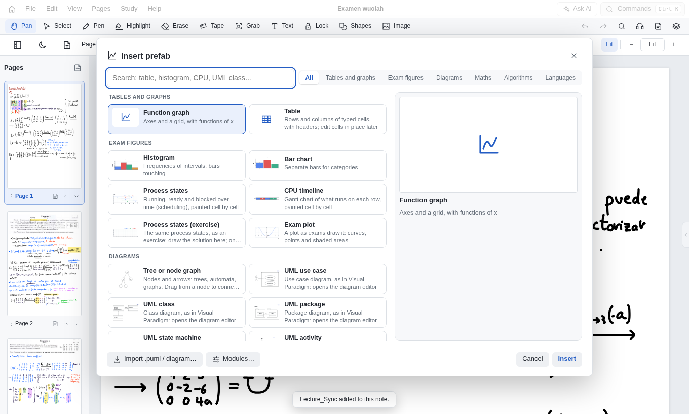
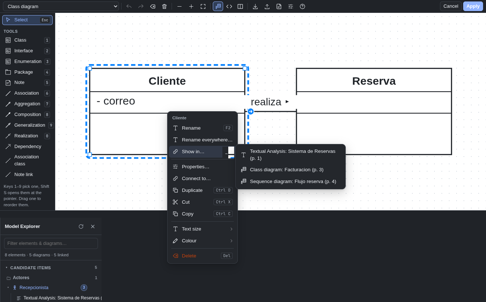
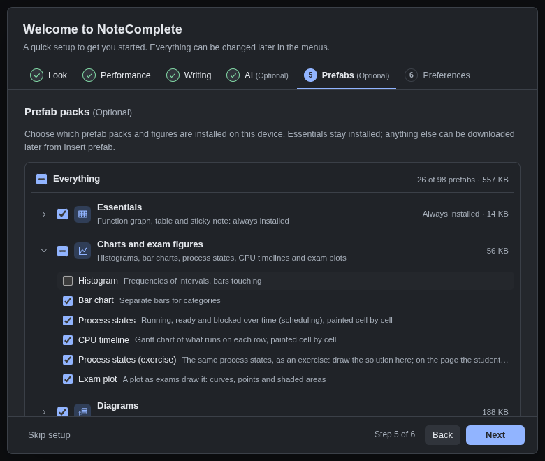
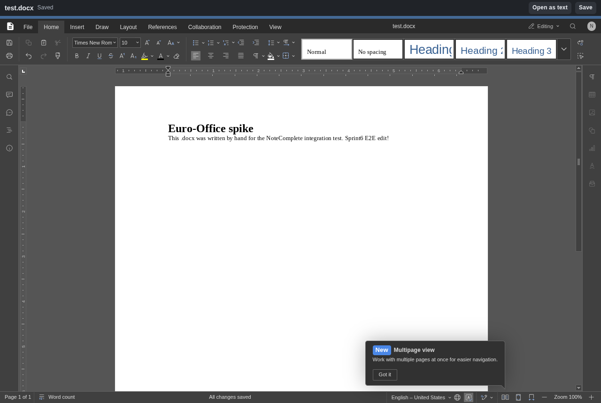
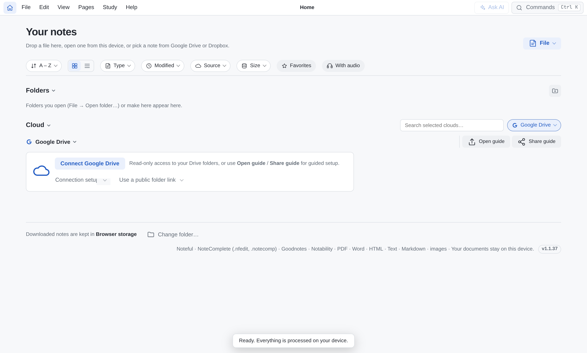
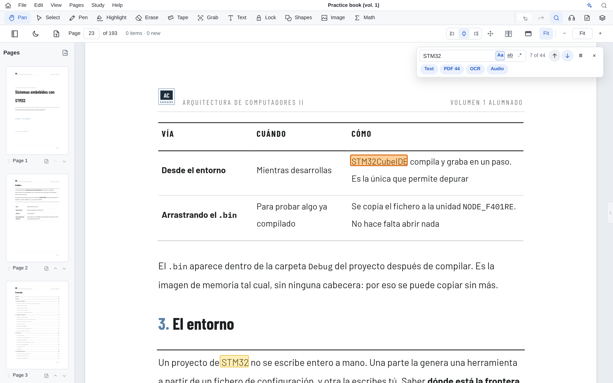
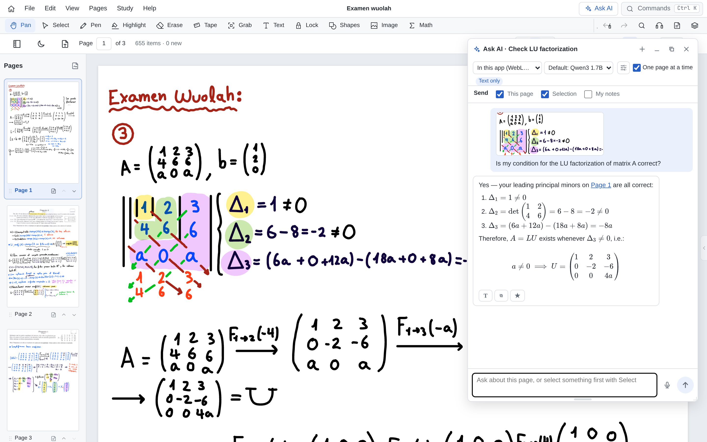

<p align="center"></p>

<p align="center">
  <a href="https://github.com/Emefedez/NoteComplete/stargazers"></a>
  <a href="https://github.com/Emefedez/NoteComplete/releases"></a>
  
  
  
  
  <a href="https://emefedez.github.io/NoteComplete/"></a>
</p>

<p align="center">
  <code>.nfedit</code> · <code>.notecomp / .notepart</code> · <code>.noteful</code> · <code>.goodnotes</code> · <code>.ntb</code> · <code>.rnote</code> · <code>Apple Notes</code> · <code>PDF</code> · <code>Markdown</code> · <code>HTML</code> · <code>Office / ODF</code> · <code>EPUB / IPYNB</code> · <code>PlantUML</code> · <code>R / Rmd / qmd</code> · <code>Audio / Video</code>
</p>

# NoteComplete

**Handwritten notes, PDFs, Markdown, Chinese tools, and AI study — local-first, on every screen.**

Everything runs on your device with no account required. Try it in the browser at **[emefedez.github.io/NoteComplete](https://emefedez.github.io/NoteComplete/)**. See [docs/USER_GUIDE.md](docs/USER_GUIDE.md) for the full feature reference and [docs/REVERSE_ENGINEERING.md](docs/REVERSE_ENGINEERING.md) for notebook format notes.

<p align="center"></p>

## Features

### Read & Annotate

<details open>
<summary><b>Drawing, Pages &amp; Notebook Compatibility</b></summary>

- **Ink & annotation tools:** Pressure-sensitive Pen, smart Highlighter, Eraser, auto-snap Shapes, Tape, Grab, Lock, and z-order stacking.
- **Flexible pages & canvases:** Mix fixed pages and multiple infinite canvases per note, 2-up spread, Dark pages (`D`), and configurable PDF preloading.
- **Other apps' notebooks:** Open **Noteful**, **Goodnotes** (`.goodnotes`), **Notability** (`.ntb`), and **Rnote** (`.rnote`) notebooks as editable notes, or import **Apple Notes** directly from `NoteStore.sqlite` (protobuf + CRDT tables, headings, checklists, highlights, hashtags, folders) and iCloud/Markdown/HTML `.zip` exports.
- **Quick menu & export:** Pen side-button / `Shift+S` radial menu, dockable toolbar, automatic recovery, and export to PDF, SVG, images, `.odt`, or Anki.

</details>

<details open>
<summary><b>Text, Markdown &amp; Math Adaptation</b></summary>

- **Split Markdown editor & Side Notes (`N`):** Live KaTeX math, PlantUML, `==highlighting==`, clickable prefab pills, independent Edit/View zoom, and page-linked side notes.
- **Math Adaptation & bilingual cheat sheet:** Highlight math shorthand anywhere — or press **`Shift+Right-click`** for instant conversion — to turn it into LaTeX (`-^x` → `\bar{x}`, `(8 sobre 5)` → `\binom{8}{5}`, annotated `=(como y=7)=`), with a searchable EN/ES cheat sheet (`?`) showing notation, LaTeX, and live KaTeX previews.
- **Math Mode (`∑ Math`) & R Commander Studio:** Live formula bar with built-in CAS (`=`, `d/dx`, `∫`, `Solve`), function plotting, one-click R Commander Studio install, and live `.R` / `.Rmd` / `.qmd` workspaces.
- **Documents, slides, spreadsheets & e-books:** Open Word, Excel, PowerPoint, ODF, RTF, CSV, EPUB, and Jupyter notebooks as editable Markdown — or edit Office files natively with **Euro-Office**.

<p align="center"></p>

</details>

<details open>
<summary><b>Chinese &amp; Translation</b></summary>

- **Built-in Chinese IME (`中`):** Tone-digit and accent input with fuzzy suggestions and keyboard candidate navigation.
- **Pinyin over characters (`拼`), Look up & Stroke order:** Tone-colored ruby annotations, right-click ES/EN dictionary with character decomposition, audio, and animated stroke practice.
- **Universal right-click Translate:** Translate highlighted text anywhere across 33+ languages with ★ favorites and one-click Replace.

<p align="center"></p>

</details>

<details open>
<summary><b>Prefabs &amp; Diagrams</b></summary>

- **Editable figures (`Shift+X`):** Sticky notes, rich tables (`Shift+Y`), graphs, charts, CPU timelines, UML diagrams (Visual Paradigm XML/XMI), Textual Analysis, and R statistics plots.
- **Model Explorer (`View → Model Explorer`):** Cross-note index of UML elements and candidates with **Show in…** jumping and global rename.
- **On-demand packs & Kept snippets:** Download optional prefab packs as needed and pin Grab snippets to `★ Kept` while solving exercises.

<p align="center"></p>
<p align="center">
  
  
</p>

</details>

<details open>
<summary><b>Audio, Media &amp; Native Office Suite</b></summary>

- **Synced note audio & global player:** Record or import audio with tap-ink-to-seek playback, or play standalone audio files from a compact top-bar player; videos hand off to your system player.
- **Optional Euro-Office module:** Edit Word, Excel, PowerPoint, and ODF files directly in a NoteComplete tab with one-click prerequisite setup (`pasta` on Linux, WSL2 on Windows, Podman on macOS).

<p align="center"></p>

</details>

---

### Library, Cloud, Moodle & Search

- **Local folders & Recent:** Open disk folders as collapsible sidebar groups, browse folder-by-folder on Home, star/tag/filter files, and switch between cover cards and list view.
- **Cloud & Moodle:** Connect **Google Drive**, **Dropbox**, **Nextcloud / WebDAV**, **Internet Archive**, **GitHub**, and **Moodle** courses (deadlines, grades, announcements, interactive MCP tools, batch downloads) — configurable from Home or the Setup wizard and searchable from one box on Home.
- **Formula Find & Batch OCR (`Ctrl+F`):** Formula-aware search with **Aa** (case), **ab** (whole word), and **.\*** (regex) toggles across typed text, PDFs, transcripts, and on-device handwriting OCR.

<p align="center"></p>
<p align="center"></p>

---

### Study & AI

All AI features run through **your own AI subscription** on desktop (Claude Code, Codex, Antigravity, OpenCode, or T3 Code, with automatic failover) or local **WebLLM** in the browser — sending only the page or snippet you choose.

<details open>
<summary><b>Ask AI, Flashcards, Quizzes, Handwriting Synthesis &amp; MCP</b></summary>

- **Ask AI (`Ctrl+J`) & Scratchpad:** Chat about the current page, Grab regions, or pasted images (`Ctrl+V` — images stay visible in sent bubbles and Scratchpad, click to enlarge) with clickable page links.
- **Flashcards, Quizzes & Fact Check:** Background-generated resumable quizzes (Hints, Clarify, Dispute, Double check), math-rendered flashcards with Anki export, and page Fact Check (`Shift+F`).
- **Handwriting synthesis & Transcription:** Convert Markdown + math into editable, searchable handwriting ink, and transcribe recordings locally with Whisper/Voxtype + word-level timestamps.
- **Bundled MCP Server:** One-click *Help → Connect AI tools…* lets agents read notes, edit Markdown, insert prefabs, write handwriting, and manage Google Drive backups ([docs/MCP.md](docs/MCP.md)).

<p align="center"></p>

</details>

---

### Live Sharing, Desktop, Web & Mobile

- **Live sessions & Drawing Tablet:** Share notes live over local Wi-Fi or an encrypted Cloudflare link, or scan a QR code to turn any phone/tablet into a low-latency pen tablet.
- **Cross-platform workspace:** Multi-tab/multi-window desktop app, first-run Setup wizard, custom themes, command palette (`Ctrl+K`), automatic updates, and an adaptive offline PWA for mobile/tablets.

---

## The `.nfedit` format

NoteComplete saves natively as **`.nfedit`** — a non-destructive archive ([spec](spec/nfedit-v1.md)) bundling your original source file (`.noteful`, `.pdf`, `.goodnotes`, `.ntb`, `.rnote`, or images) alongside strokes, undo history, side Markdown notes, OCR text, audio/transcripts, study decks, Chinese overrides, and editable prefabs. Lighter siblings: **`.notecomp`** and **`.notepart`**.

---

## Get it

- **Installers:** [GitHub Releases](https://github.com/Emefedez/NoteComplete/releases) (Linux AppImage, macOS DMG/ZIP, Windows installer, Android APK · [build notes](docs/BUILDS.md))
- **Build from source:**

```sh
# Requirements: Rust 1.93+, Node 22.13+, Python 3.11+
rustup target add wasm32-unknown-unknown
cargo install wasm-bindgen-cli --version 0.2.128 --locked --root work/wasm-tools
python3 tools/build_web.py
node tools/serve_web.mjs 8767          # http://127.0.0.1:8767/
```

Desktop: `cd apps/desktop && npm ci && npm run stage && npm start` (or `python3 tools/update_appimage.py` on Linux). Mobile: `cd apps/mobile && npm ci && npm start`.

More docs: [User Guide](docs/USER_GUIDE.md) · [MCP & AI Agents](docs/MCP.md) · [Google Drive & Dropbox](docs/GOOGLE_DRIVE.md) · [Performance](docs/PERFORMANCE.md) · [Changelog](docs/CHANGELOG.md) · [Development](DEVELOPMENT.md).
