<p align="center">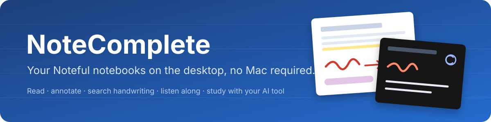</p>

# NoteComplete

**Your Noteful notebooks on the desktop, no Mac required.**

NoteComplete is an independent desktop and web companion for people who take notes in [Noteful](https://noteful.app) on an iPad. It opens `.noteful` notebooks on Linux (the main target today), Windows, macOS or in a browser, so you can read, review, search and study your notes from your computer while the iPad stays your notebook.

> NoteComplete is not affiliated with or endorsed by Noteful. It reads the format through independent reverse engineering; see [How it reads Noteful files](#how-it-reads-noteful-files).

<p align="center">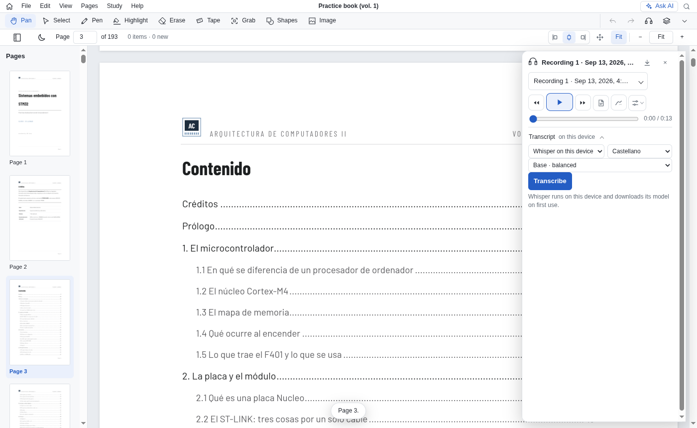</p>

## What it does

### Read and annotate
- **Everything in a notebook**: PDF and paper backgrounds, handwriting, highlighter, shapes, images (crops included), typed text, tape, locked items, tags and recordings, up to notebooks of hundreds of pages.
- **Edit**: pen, highlighter, eraser, shapes, tape, text boxes, crop, layers, undo/redo; move, resize and lock items. The original file is never changed.
- **New documents** (<kbd>Ctrl</kbd>+<kbd>N</kbd>): blank pages of any size, saved as `.notecomp`, `.notepart` or `.noteful`.
- **Pages**: add blank pages or pages from another PDF; resize a page from a menu or by dragging its borders.
- **Select and copy text** from PDFs and recognized handwriting.
- **Night view** (<kbd>D</kbd>) inverts the page colours. A **light/dark theme** switch is in View.
- **Export**: the note (Noteful, Noteful + Markdown, NoteComplete), pages as SVG, PDF or images, study material as Anki.

<p align="center">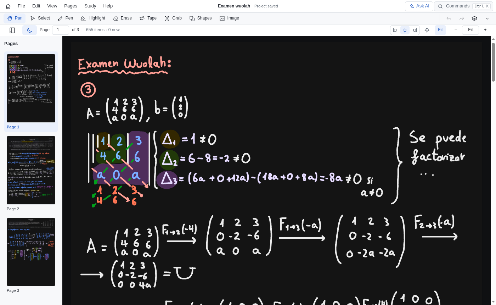</p>

### Notes in Markdown
A **Notes** panel (<kbd>N</kbd>) beside the pages, with a formatted preview. **+ Page** ties a section to a page; the notes follow you as you turn pages, and Ask AI can read them. The **Scratchpad** (View → Scratchpad…) keeps AI conversations you want with the note. Saved with the note, or as one `.notecomp` file.

### Your library
- **Google Drive on Home**: connect read-only and open your Noteful backup folder; notes appear as cards with their real covers, or as a quick list.
- **Filters and sorting** by type, date, size, recordings and Noteful tags.
- **Opens** `.noteful`, `.notepart`, `.notecomp`, `.nfedit` projects, PDFs and images, from Drive or your computer.
- **Kept on this device** in a folder you choose; a note is never downloaded twice.
- **Newer versions**: if the iPad saved a newer copy, choose it, keep yours, keep both or **compare** page by page. Flashcards, quizzes, notes and recordings can come along; **Migrate content to file…** moves them by hand.

<p align="center">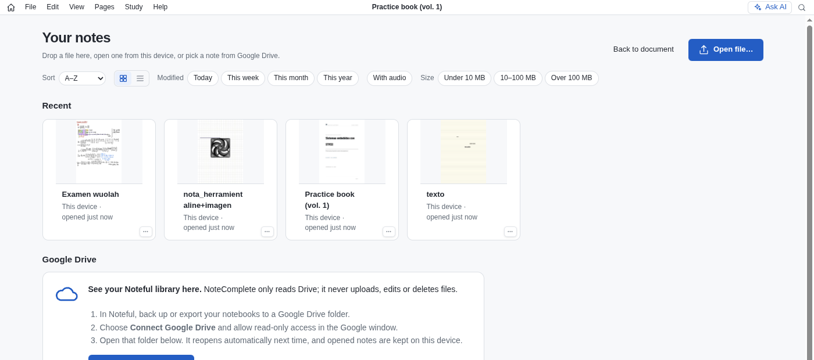</p>

### Find anything
One search (<kbd>Ctrl</kbd>+<kbd>F</kbd>) over typed text, PDF text, transcripts and recognized handwriting, limited to any mix of sources. Handwriting recognition runs on this device.

<p align="center">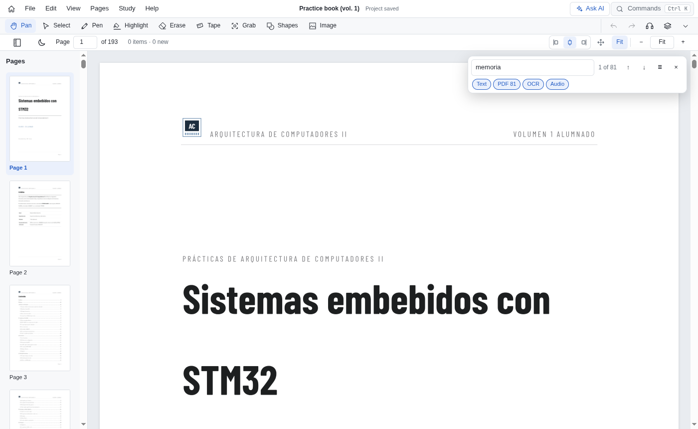</p>

### Listen along
Play recordings with the handwriting appearing as it was written, tap ink to seek, **record** from the microphone or **import** audio into any note. Transcribe with Whisper on the device, Voxtype or Gemini through Antigravity; your AI tool can then **revise** the text while every word keeps its time. Export as text, SRT, WebVTT or JSON.

### Study with your AI subscription
Flashcards and quizzes are generated in the background by the tool you already use (Claude Code, Antigravity or Codex) from page images and text.
- **Quizzes** are saved and resumable. **Hint** (<kbd>H</kbd>) shows where your notes answer it; **Clarify** (<kbd>C</kbd>) explains it and keeps the answer; **Dispute** (<kbd>X</kbd>) and **Double check** (<kbd>V</kbd>) question the quiz; wrong answers can be retaken; **Restart** with the circular arrow (press twice).
- They are also **generated in the background** so you can keep studying while your material is being created.
- **Flashcards** are practised in a floating window, with formulas and lists rendered. **Ask AI** (<kbd>C</kbd>) explains a card using its page, source PDF, your notes or the whole note, and keeps the answer with the card. **Edit**, **Double check** and **Discard** fix a card on the spot.
- Quiz and flashcard windows **grow to fit** the answer as it streams in.
- **Ask AI** (<kbd>Ctrl</kbd>+<kbd>J</kbd>) answers about a page, a region or your notes. Follow-ups from cards and quizzes continue there.
- **Paste images** (<kbd>Ctrl</kbd>+<kbd>V</kbd>) into any AI question. Questions can be dictated with the mic.
- **Links in answers** work: pages jump to the page, images open large, web links open in the browser.
- **Study material** (Study → All quizzes and decks…): everything on this device in two lists, exportable to Anki.
- The sun in the study windows **dims everything behind them**.
- The bundled MCP server lets agents read your notebooks and write Markdown notes into them ([AI agents](docs/MCP.md)).

<p align="center">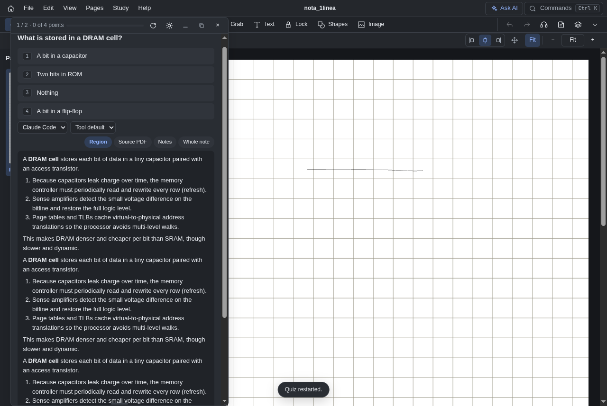 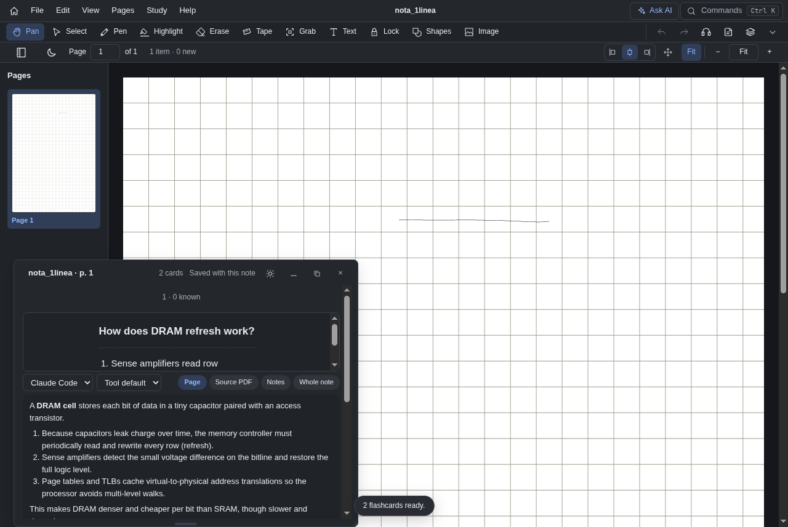</p>
<p align="center">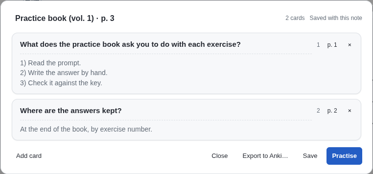</p>
<p align="center">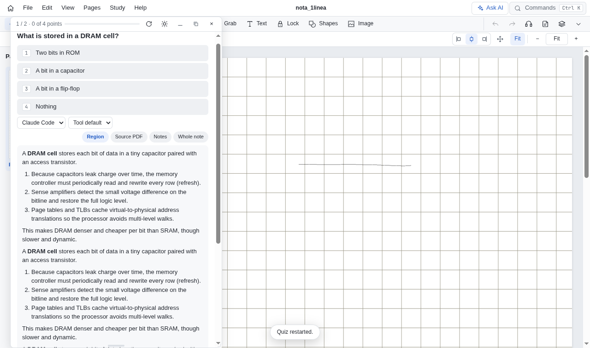</p>
<p align ="center">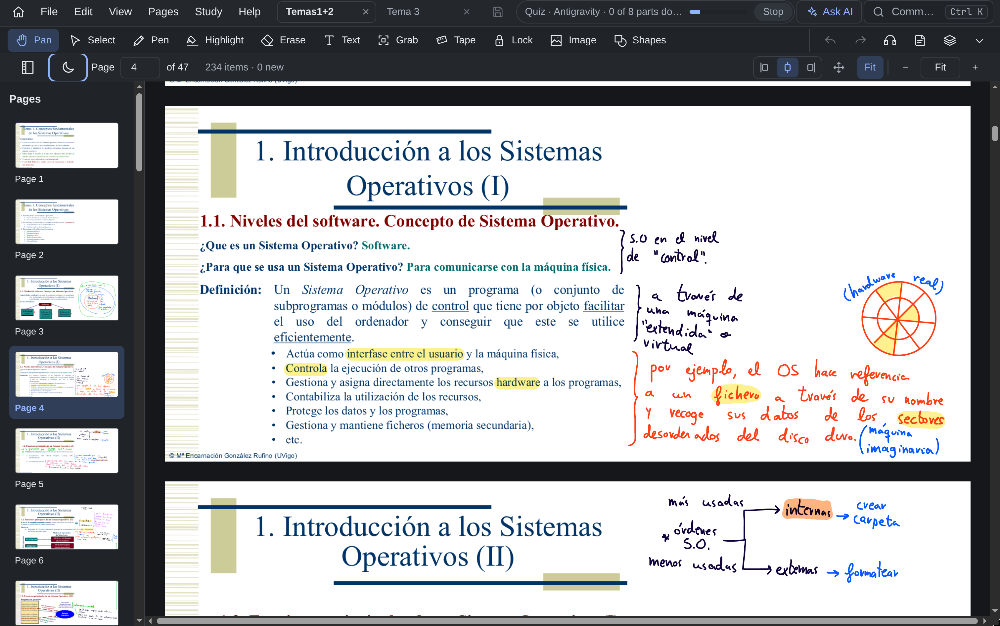

### Feels like a desktop app
- **Tabs and windows** (<kbd>Ctrl</kbd>+<kbd>T</kbd>); drag a tab out for its own window.
- **Floating windows** for Ask AI, audio, quizzes and flashcards: drag anywhere, resize from any edge, put away in a tray.
- **Narrow windows and phones**: two bottom bars; tools turn into icons before the toolbar wraps.
- **Updates**: checked on open, installed only when you agree.
- **Command search** (<kbd>Ctrl</kbd>+<kbd>K</kbd>), single-key shortcuts, and <kbd>?</kbd> to show each button's key.
- **Interface size** with <kbd>Ctrl</kbd>+<kbd>Shift</kbd>+<kbd>−</kbd> / <kbd>+</kbd> / <kbd>0</kbd>.

<p align="center">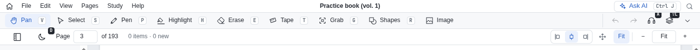</p>

**Private by default**: everything is processed locally. Drive access is read-only unless you choose to upload or delete. AI features use your own tools and send only what you choose (by default the current page); only Gemini transcription sends audio off the device.

Screenshots use the sample notes in [`samples/`](samples/).

## Get it

**Installers.** Tagged releases attach Linux AppImages (x86-64 and ARM64), macOS DMG/ZIP (Apple Silicon and Intel), a Windows installer and an Android APK preview. Builds are unsigned previews; Linux is the tested platform for now. See [builds](docs/BUILDS.md).

**Browser.** Build and serve the web app (below), then open it in any modern browser. It also installs as a PWA.

### Getting notes from the iPad

1. In Noteful, back up or export your notebooks to a Google Drive folder (or copy `.noteful` files to your computer any other way).
2. In NoteComplete choose **Connect Google Drive** on Home, allow read-only access, and open that folder. Or use **File → Open…** for a local note, project, PDF or image.
3. Save your work with **File → Save project** (`.nfedit`, keeps the original plus your edits), or export from **File → Export**: `.noteful` (experimental: modified exports have not yet been verified in Noteful itself), the note with its Markdown, or one `.notecomp` file with the note, its notes and added recordings.

AI agents (MCP): [docs/MCP.md](docs/MCP.md). Drive setup for self-hosted builds (OAuth client, API key for public folder links) is in [Google Drive](docs/GOOGLE_DRIVE.md). Controls, audio and quality settings are in the [user guide](docs/USER_GUIDE.md).

## Known issues

- Exports to `.noteful` after editing, crops made in NoteComplete included, have not yet been verified in Noteful itself.
- No release has been published yet, so the update check has nothing to find until one is.
- Uploading a change to Google Drive and deleting a note there are tested against a fake server only.
- A tab dragged out of the tab strip opens in its own window, but cannot be dropped onto another window's strip: Wayland does not tell the app where the pointer is outside its own windows.
- The Google Drive sign-in is not remembered between sessions, so Recent can only check Drive for newer versions after you connect (or for a public folder with an API key).
- Installers are unsigned previews, and Linux is the only tested platform.
- Every request and its state (`[D]` done, `[!]` not yet verified, `[ ]` to do) is in [docs/REQUESTS.md](docs/REQUESTS.md).

## Roadmap

Planned, not started (details in [docs/REQUESTS.md](docs/REQUESTS.md)):
- **The open NoteComplete format**: today `.notecomp` and `.notepart` are an archive of the note, its Markdown and added recordings; the plan is an open, documented ZIP package with pages, resources, notes and study material, chosen on first save for every note (New document already asks). Files saved today keep opening: they are recognised by content.
- **Choose which pages to export**: this page, a range, a list or every page, for SVG, PDF and images.
- **Repositories** as a library source next to Google Drive: GitHub repositories with notes, files and solved exams, browsed from Home.
- **Infinite canvas** in `.notecomplete`, split into sheets of up to Noteful's maximum page size when saved as `.noteful`.

## Build from source

Requirements: Rust 1.93+, Node 22.13+ and Python 3.11+.

```sh
rustup target add wasm32-unknown-unknown
cargo install wasm-bindgen-cli --version 0.2.128 --locked --root work/wasm-tools
python3 tools/build_web.py
node tools/serve_web.mjs 8767          # http://127.0.0.1:8767/
```

Desktop: `cd apps/desktop && npm ci && npm run stage && npm start` (or `npm run dist` for a package). Mobile (Expo Go, SDK 57): `cd apps/mobile && npm ci && npm start`. Package workflows and signing limits: [builds](docs/BUILDS.md).

Checks:

```sh
cargo fmt --all --check && cargo clippy --workspace --all-targets --locked -- -D warnings
cargo test --workspace --locked
node --test apps/reader/*.test.mjs apps/mobile/*.test.mjs apps/desktop/*.test.mjs tools/*.test.mjs
node apps/reader/test.mjs              # after a web build
```

## How it reads Noteful files

Noteful's format is undocumented. NoteComplete's Rust core comes from the noteful-re reverse-engineering effort. Its tools and evidence (Ghidra scripts, the independent Python oracle, the legacy viewer and the parity checks) are kept on the [`reverse-engineering`](https://github.com/Emefedez/noteful-re/tree/reverse-engineering) branch of this repository, where a short writeup of how the format was worked out will be published. The resulting [format specification](spec/noteful-v0.1.md) is kept here.

Related work: [noteful-mcp](https://github.com/openninoor/noteful-mcp) (MIT) independently reads and writes Noteful notebooks for AI agents.

## Repository

| Directory | Purpose |
|---|---|
| `apps/reader/` | The NoteComplete app (web, and the UI of every build) |
| `apps/desktop/`, `apps/mobile/` | Electron desktop shell and Expo wrapper |
| `crates/` | Rust core (format, scene, editing, export), CLI and WASM adapter |
| `docs/` | User guide, Google Drive, builds, release notes |
| `spec/`, `samples/`, `tests/fixtures/` | Format specification the core implements, sample corpus and synthetic fixtures |
| `tools/` | Web build, local server and Expo helpers |
| `skills/` | Claude Code skills that came out of this project ([polished-apps](skills/polished-apps/SKILL.md): how apps like this one are built) |

Development procedure and architecture: [DEVELOPMENT.md](DEVELOPMENT.md).
