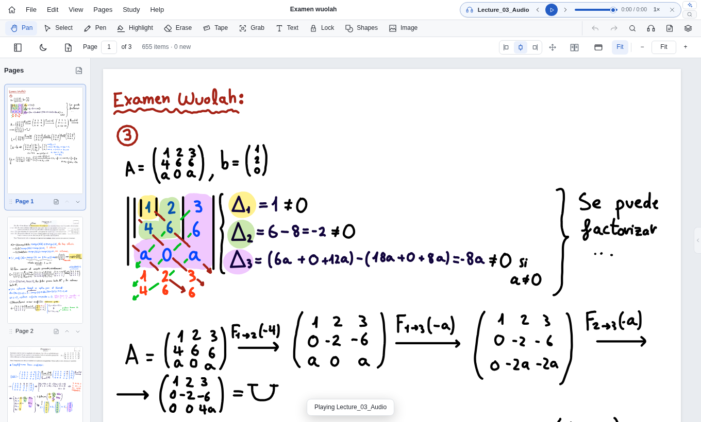
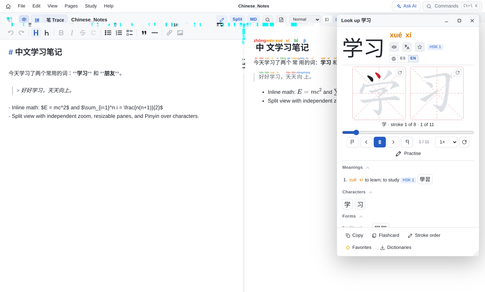
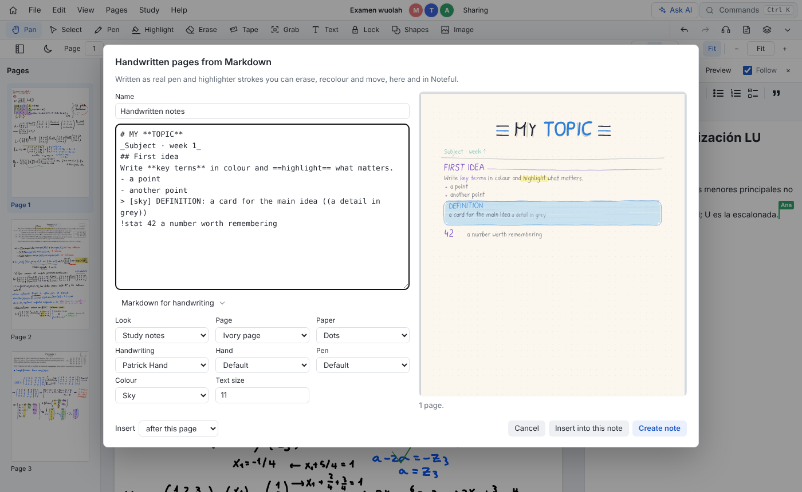

<p align="center"></p>

# NoteComplete

**Handwritten notes, PDFs, Markdown, Chinese tools, and AI study — local-first, on every screen.**

NoteComplete runs on **Linux** (primary desktop target), **Windows**, **macOS**, **Android**, and any **browser** (including iPhone and iPad as an installable offline web app). Everything is processed on your device with no account required.

- **Try in the browser:** [emefedez.github.io/NoteComplete](https://emefedez.github.io/NoteComplete/) (opens with an interactive welcome notebook; toggle via *Help → Open the welcome note at start*).
- **Compatibility:** native `.nfedit` projects plus local import/export for `.noteful`, `.goodnotes`, `.ntb`, PDFs, Office files, Markdown, images, archives, and MP3/MP4 media ([format interoperability & reverse-engineering notes](docs/REVERSE_ENGINEERING.md)).

<p align="center"></p>

## Features

### Read & Annotate

<details open>
<summary><b>Drawing &amp; Pages</b></summary>

- **Ink & annotation tools:** Pen (pressure & smoothing), Highlighter (blends & snaps to PDF words), Eraser, Shapes (pen-hold auto-snap), Tape (tap to lift/cover), Grab (copy text, ask AI, keep for exercises, or erase region), Lock.
- **Quick menu & gestures:** `Shift+S`, pen side button, or two-finger hold; two-finger pinch/scroll/undo, three-finger redo; drag tools to reorder; dockable toolbar (top, bottom, left, right).
- **Pages & canvas:** Infinite canvas or fixed pages; insert blank/PDF pages; drag borders to resize; side-by-side 2-up spread; 3-way page alignment; Dark pages (`D`) & Light/Dark/System themes.
- **Auto-save & export:** Automatic local recovery slots; export pages to PDF, SVG, PNG/JPEG, or Anki study decks.

</details>

<details open>
<summary><b>Text &amp; Markdown</b></summary>

- **Page text boxes:** Rich font/size/style/color formatting, live KaTeX math (`∑` or `$...$`) with touch math keypad, direct move without leaving Text mode (hold/drag box, drag `⋮⋮` grip, or drag outside with no selection).
- **Standalone & split Markdown editor:** Resizable split panes, independent **Edit** and **View** zoom (`Ctrl/⌘ + wheel`), content width & 3-way snap alignment, live LaTeX math, PlantUML diagrams, and clickable prefab medallions (double-click to edit).
- **Side Notes (`N`):** Per-document Markdown notes linked to pages with `+ Page`.

</details>

<details open>
<summary><b>Chinese &amp; Translation</b></summary>

- **Built-in Chinese IME (`中` / `ā`):** Hanzi and tone-marked Pinyin modes with mid-syllable tone digits (`zho1ngwen`), dead-key accents (`xué`), fuzzy typo suggestions (`≈`), 2D arrow-key candidate navigation, `Space` / `Enter` / `Shift+1–9` selection, and opt-in full-width punctuation.
- **Pinyin over characters (`拼` / `View → Pinyin over characters`):** Live tone-colored ruby annotations on page text boxes, Markdown, and exports, with per-character reading overrides.
- **Look up & Stroke order:** Right-click any Chinese character/word for meanings (`ES | EN`), radical & component meanings in **Structure**, audio pronunciation, interactive stroke-order player & handwriting practice (with synced per-character/all repeat toggles), Favorites, and downloadable HSK or local CC-CEDICT/JSON/TSV dictionaries.
- **Universal right-click Translate:** Highlight any text anywhere → right-click **Translate** with favorite target languages (**Español**, **English**, **中文 (简体)** by default), searchable 33+ language picker with ★ favorites, and one-click **Replace** in editable fields.

<p align="center"></p>

</details>

<details>
<summary><b>Prefabs &amp; Diagrams</b></summary>

- **Editable exam figures (`Shift+X`):** Function graphs, histograms, bar charts, process states & CPU timelines (tap-to-paint exercises), trees, node graphs, tables (`Shift+Y`), stroke-order sheets, and UML diagrams (Visual Paradigm XML & XMI import/export).
- **Kept for exercises:** Keep Grab snippets in a floating viewer / top-bar `★ Kept` pill while building charts or solving problems.

</details>

<details>
<summary><b>Audio &amp; Media</b></summary>

- **Global-bar MP3 player:** Opening any `.mp3` (from a folder, `File → Open…`, drag-and-drop, archive, or cloud) shows a compact accent-colored player on the top bar (headset mute, back/play-pause/forward, scrub bar, speed `0.5×–2×`, close) without leaving your note.
- **MP4 handoff:** Clicking an `.mp4` opens it directly in your computer's default media player.
- **Synced note recordings:** Record or import audio into a note with timed ink playback (tap ink to seek), segment trimming, and audio enhancement.

</details>

---

### Library, Cloud & Search

- **Local folders & Recent:** Open any folder on disk as a sidebar document group, star files, rename/trash in place, filter by type/date/source/size/audio/tags, and switch between cover cards and compact list view.
- **Cloud & repositories:** Connect **Google Drive**, **Dropbox**, **Internet Archive**, or **GitHub** note repositories directly from Home; check for newer versions, compare page-by-page, and migrate study material/notes across copies.
- **Unified Search & Batch OCR (`Ctrl+F`):** Search across typed text, PDF text, audio transcripts, and on-device handwriting OCR (multi-language), or search text across your entire library from Home.

<p align="center"></p>

---

### Study & AI

All AI features run through **your own existing AI subscription** on desktop (Claude Code, Codex, Antigravity, or OpenCode) or an optional local **WebLLM** model in the browser — sending only the page/selection you choose.

<details open>
<summary><b>AI Study Tools, Handwriting Synthesis, Transcription &amp; MCP</b></summary>

- **Ask AI (`Ctrl+J`) & Scratchpad:** Chat about the current page, a Grab region, pasted images (`Ctrl+V`), or dictated questions; save useful threads in the note's Scratchpad; clickable links jump straight to pages or open images.
- **Flashcards & Quizzes (background generation):** Resumable quizzes with page **Hints** (`H`), **Clarify** (`C`), **Dispute** (`X`), **Double check** (`V`), and wrong-answer retakes; floating flashcards with math rendering, per-card **Ask AI**, inline editing, and Anki export (`Shift+E`).
- **Fact Check (`Shift+F`):** Check pages for calculation, date, or consistency errors.
- **Handwriting from Markdown & New Note with AI:** Turn Markdown + math into real, editable, immediately searchable handwriting ink (`File → New note…`) with live preview, or have your AI tool draft full handwritten notebooks from a topic or folder.
- **Speech Transcription & AI Revision:** Local Whisper (browser/desktop) or Voxtype transcription with word-level timestamps, click-to-seek, SRT/VTT/JSON export, and AI transcript revision that preserves timings and flags classroom noise.
- **Bundled MCP Server:** One-click *Help → Connect AI tools…* registers NoteComplete's MCP server so agents can read notes, edit Markdown, and write editable handwriting ([docs/MCP.md](docs/MCP.md)).

<p align="center"></p>

</details>

---

### Live Sharing & Drawing Tablet

From the desktop app's **Share** menu:
- **Live sessions:** Invite guests on local Wi-Fi (QR / PIN) or over a temporary encrypted Cloudflare link to follow pages live, co-edit Markdown notes, and optionally draw together.
- **Phone / tablet as a drawing tablet:** Scan the QR code to turn any phone or tablet into a low-latency pen canvas for the note open on your computer.

---

### Desktop, Web & Mobile

- **Multi-tab & multi-window** (`Ctrl+T`, drag tab out), floating resizable windows with a shared tray, command palette (`Ctrl+K`), keyboard shortcut badges (`?`), interface zoom (`Ctrl+Shift+−/+/0`), and automatic update checks.
- **Adaptive mobile & narrow layout:** Compact bottom bars, horizontally scrollable tool rows with edge fades, touch-friendly zoom/drag handling, and offline PWA support.

---

## The `.nfedit` format

NoteComplete saves notes natively as **`.nfedit`** — a single non-destructive archive ([spec](spec/nfedit-v1.md)) that keeps everything belonging to a document together without mutating your original file:

| Stored inside `.nfedit` | What it preserves |
| --- | --- |
| **Original source file** | Untouched `.noteful`, `.pdf`, `.goodnotes`, `.ntb`, or image base |
| **Edits & full history** | Every stroke, shape, text box, crop, layer change, and full undo/redo timeline |
| **Markdown notes** | Side-panel notes (`N`) and `+ Page` section links |
| **Searchable text & OCR** | Recognized handwriting text and synthesized Markdown-handwriting text |
| **Audio & transcripts** | Added recordings, ink-sync timings, and word-level transcripts |
| **Study material** | Saved flashcard decks, resumable quizzes, and AI Scratchpad threads |
| **Chinese metadata** | Note Pinyin-over-characters toggle, script preference, and per-character reading overrides |
| **Prefabs & interactive HTML** | Editable figure/diagram specs and embedded interactive exam HTML |

You can also export directly to **`.noteful`**, **PDF**, **SVG**, **images**, **Markdown**, or **Anki** decks. NoteComplete opens PDFs, images, HTML, Markdown, code/text, Word (`.docx`/`.odt`), Excel/CSV (`.xlsx`/`.ods`/`.csv`/`.tsv`), PlantUML, ZIP/TAR archives, `.mp3` audio, and `.mp4` video. For technical details on `.noteful`, Goodnotes, and Notability compatibility, see [docs/REVERSE_ENGINEERING.md](docs/REVERSE_ENGINEERING.md).

---

## Get it

- **Installers:** [GitHub Releases](https://github.com/Emefedez/NoteComplete/releases) — Linux AppImages (x86-64 & ARM64), macOS DMG/ZIP (Apple Silicon & Intel), Windows installer, and Android APK preview, with `SHA256SUMS.txt`. Builds are unsigned previews; Linux is the primary tested desktop platform ([docs/BUILDS.md](docs/BUILDS.md)).
- **Web app (desktop, iOS, iPadOS, Android):** [emefedez.github.io/NoteComplete](https://emefedez.github.io/NoteComplete/) — works offline once installed via *Add to Home Screen* / *Install*.

More docs: [User Guide](docs/USER_GUIDE.md) · [MCP & AI Agents](docs/MCP.md) · [Google Drive & Dropbox](docs/GOOGLE_DRIVE.md) · [Performance](docs/PERFORMANCE.md) · [Changelog](docs/CHANGELOG.md).

---

## Build from source

Requirements: Rust 1.93+, Node 22.13+, Python 3.11+.

```sh
rustup target add wasm32-unknown-unknown
cargo install wasm-bindgen-cli --version 0.2.128 --locked --root work/wasm-tools
python3 tools/build_web.py
node tools/serve_web.mjs 8767          # http://127.0.0.1:8767/
```

- **Desktop:** `cd apps/desktop && npm ci && npm run stage && npm start` (or `python3 tools/update_appimage.py` on Linux).
- **Mobile (Expo SDK 57):** `cd apps/mobile && npm ci && npm start`.
- **Tests:** `cargo test --workspace --locked`, `node --test apps/reader/*.test.mjs apps/reader/chinese/*.test.mjs apps/desktop/*.test.mjs apps/mobile/*.test.mjs tools/*.test.mjs`, and `node apps/reader/test.mjs`.

## Open TODO

- **macOS / iOS native verification:** Verify iOS export flows and real-device `.noteful` round-trip compatibility for newly created NoteComplete notebooks on macOS/iPadOS.
- **Selective page export:** Export a chosen page range or page list (in addition to current page / all pages) to PDF, SVG, and images.

## Repository

| Directory | Purpose |
| --- | --- |
| `apps/reader/` | Core web application UI (shared by web, desktop, and mobile) |
| `apps/desktop/`, `apps/mobile/` | Electron desktop shell and Expo mobile wrapper |
| `crates/` | Rust engine (`noteful-core`, `noteful-import`, `noteful-cli`, `noteful-wasm`) |
| `docs/`, `spec/` | User docs, reverse-engineering notes, and format specifications |
| `tools/` | Build scripts, local server, AppImage repacker, and Playwright E2E/benchmarks |

Development architecture: [DEVELOPMENT.md](DEVELOPMENT.md).
