<p align="center">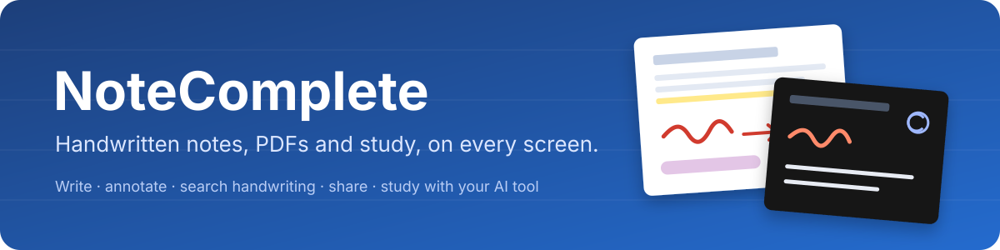</p>

# NoteComplete

**Handwritten notes, PDFs and study, on every screen.**

NoteComplete is a notebook app for handwriting, PDFs and Markdown notes, with study tools and your own AI. It runs on Linux (the main target today), Windows, macOS, Android and in any browser, iPhone and iPad included, as a web app. Write with a pen or a finger, keep Markdown notes beside the pages, search everything (handwriting included), study with flashcards and quizzes, and share a note live with people or with a phone as a drawing tablet. Everything runs on your device.

It also opens [Noteful](https://noteful.app) notebooks (`.noteful`) and saves them back, so notes taken on an iPad come along.

**Try it in the browser:** [emefedez.github.io/NoteComplete](https://emefedez.github.io/NoteComplete/). It opens with a welcome notebook written by the app itself ([its Markdown](docs/site/welcome.md)).

> NoteComplete is not affiliated with or endorsed by Noteful. It reads the format through independent reverse engineering; see [How it reads Noteful files](#how-it-reads-noteful-files).

<p align="center">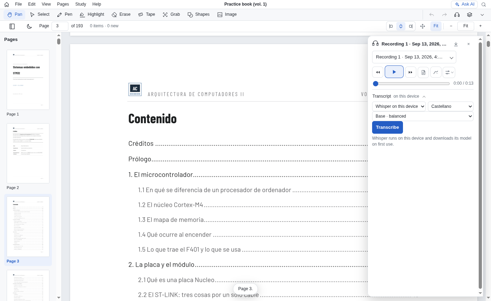</p>

## What it does

### Read and annotate
- **Everything in a notebook**: PDF and paper backgrounds, handwriting, highlighter, shapes, images (crops included), typed text, tape, locked items, tags and recordings, up to notebooks of hundreds of pages.
- **Edit**: pen (stylus pressure, on or off), highlighter, eraser, shapes (outline, tint or solid fill), tape, text boxes, crop, layers, undo/redo; move, resize and lock items. The original file is never changed.
- **Auto-save** (File menu, on by default): a copy every minute into automatic slots on this device, never over your file; reopening a note offers the newer automatic save. In a shared session the host decides for everyone, and a guest who gets disconnected keeps the note.
- **Quick menu** (<kbd>Shift</kbd> + <kbd>S</kbd>, <kbd>Shift</kbd> + pen, a pen's side button, or two fingers held still): a ring of tools around the pen; tap one and its colours, widths and modes appear around it. Hold a tool to move it on the ring.
- **Touch and stylus**: two fingers scroll (with momentum) or pinch-zoom, a two-finger tap undoes and three redo; while a stylus is in use a finger scrolls, without one a finger draws. Strokes are smoothed, and quick strokes never wait for the page to redraw. Hold a tool in the bar to rearrange it.
- **New documents** (<kbd>Ctrl</kbd>+<kbd>N</kbd>): blank pages of any size or an infinite canvas, saved as a NoteComplete project (`.nfedit`) or a Noteful file (`.noteful`); a **?** beside the choice explains the difference.
- **Pages**: add blank pages or pages from another PDF; resize a page from a menu or by dragging its borders.
- **Select and copy text** from PDFs and recognized handwriting.
- **Night view** (<kbd>D</kbd>) inverts the page colours. A **light/dark theme** switch is in View.
- **Export**: the note (Noteful, Noteful + Markdown, NoteComplete), pages as SVG, PDF or images, study material as Anki.

<p align="center">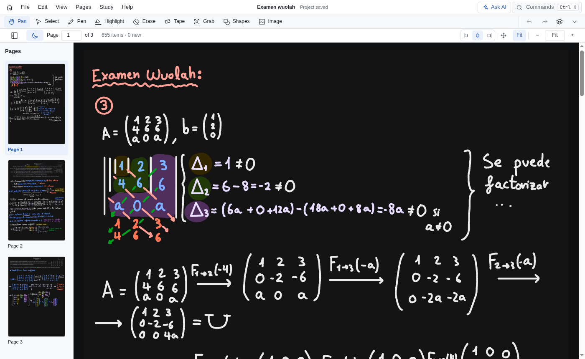</p>

### Notes in Markdown
A **Notes** panel (<kbd>N</kbd>) beside the pages, with a formatted preview. **+ Page** ties a section to a page; the notes follow you as you turn pages, and Ask AI can read them. The **Scratchpad** (View → Scratchpad…) keeps AI conversations you want with the note. Saved with the note, or as one `.notecomp` file.

### Share notes and draw on a tablet
- **Shared notes**: *Share* in the top bar (desktop) invites people to follow the note live and write its Markdown notes with you, in a browser or in NoteComplete; they draw on it too if you allow editing. Names and coloured cursors show who is where; when you end the session everyone keeps a copy.
- **Your phone or tablet as a drawing tablet**: scan the QR code (or type the 6-digit code) and draw on the note open on your computer. The device shows just the note and a tool bar (along the top or bottom when held upright, at a side when held sideways); it zooms on its own, and what you draw appears live on the computer and is saved there, with pen pressure, highlighter, eraser and undo.
- **Online access**: the local network by default; turn on online access for a temporary link through Cloudflare that works from other networks, for people and for a drawing tablet alike. On Linux the sharing panel shows the firewall command if phones cannot reach the local link ([details](docs/COLLABORATION.md)).

<p align="center">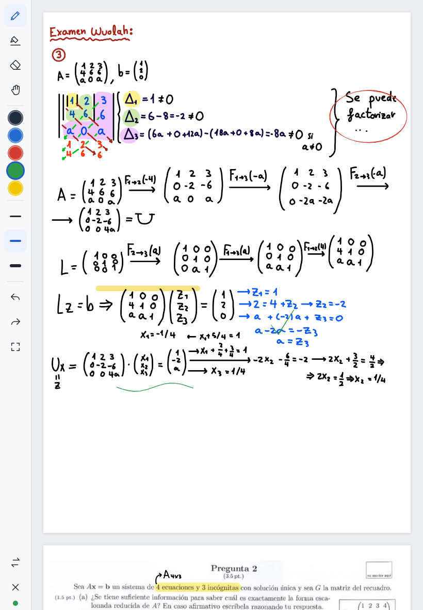 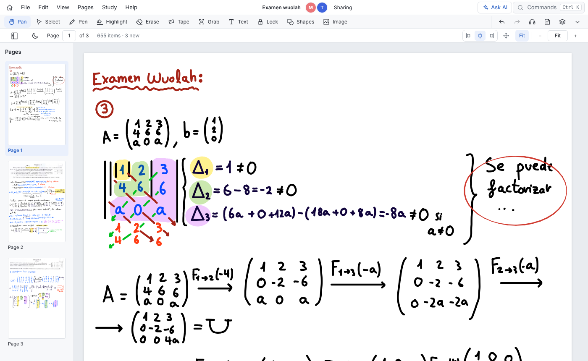</p>
<p align="center">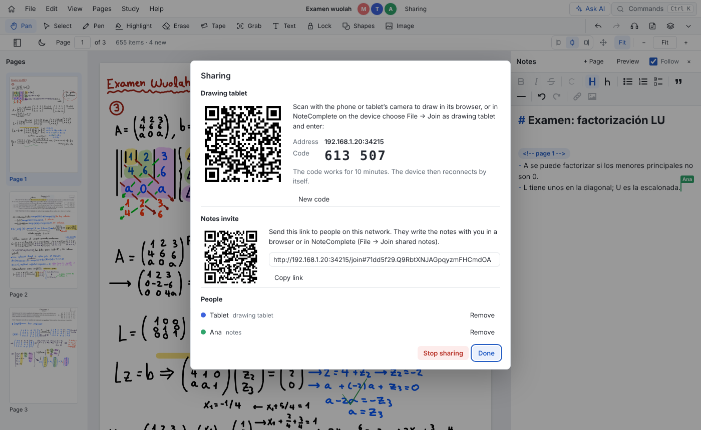</p>
<p align="center">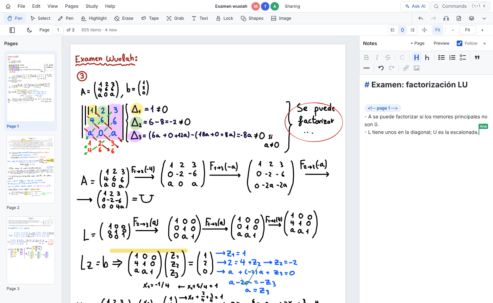</p>

### Your library
- **Google Drive on Home**: connect read-only and open a folder of notes (a Noteful backup folder works too); notes appear as cards with their real covers, or as a quick list.
- **Filters and sorting** by type, date, size, recordings and Noteful tags.
- **Opens** `.noteful`, `.notepart`, `.notecomp`, `.nfedit` projects, PDFs and images, from Drive or your computer.
- **Kept on this device** in a folder you choose; a note is never downloaded twice.
- **Newer versions**: if the iPad saved a newer copy, choose it, keep yours, keep both or **compare** page by page. Flashcards, quizzes, notes and recordings can come along; **Migrate content to file…** moves them by hand.

<p align="center">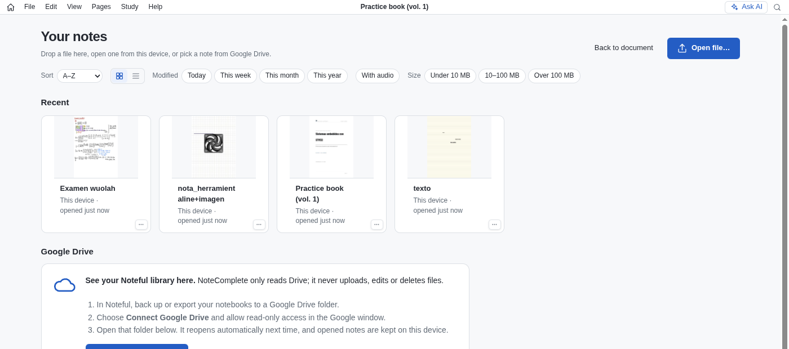</p>

### Find anything
One search (<kbd>Ctrl</kbd>+<kbd>F</kbd>) over typed text, PDF text, transcripts and recognized handwriting, limited to any mix of sources. Handwriting recognition runs on this device.

<p align="center">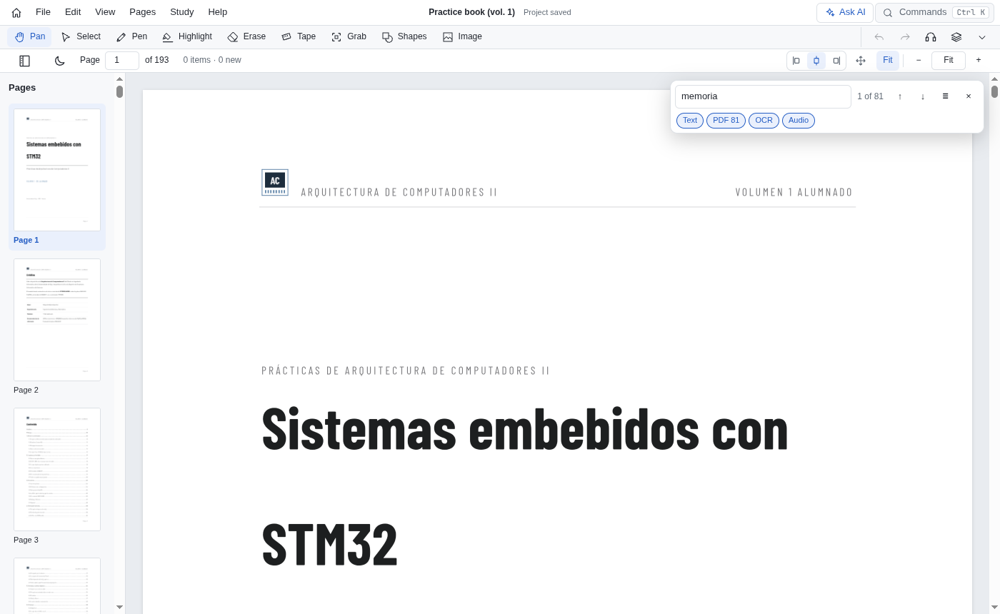</p>

### Listen along
Play recordings with the handwriting appearing as it was written, tap ink to seek, **record** from the microphone or **import** audio into any note. Transcribe with Whisper on the device, Voxtype or Gemini through Antigravity; your AI tool can then **revise** the text while every word keeps its time. Export as text, SRT, WebVTT or JSON.

### Study with your AI subscription
Flashcards and quizzes are generated in the background by the tool you already use (Claude Code, Antigravity, Codex or OpenCode) from page images and text.
- **Quizzes** are saved and resumable. **Hint** (<kbd>H</kbd>) shows where your notes answer it; **Clarify** (<kbd>C</kbd>) explains it and keeps the answer; **Dispute** (<kbd>X</kbd>) and **Double check** (<kbd>V</kbd>) question the quiz; wrong answers can be retaken; **Restart** with the circular arrow (press twice).
- They are also **generated in the background** so you can keep studying while your material is being created.
- **Flashcards** are practised in a floating window, with formulas and lists rendered. **Ask AI** (<kbd>C</kbd>) explains a card using its page, source PDF, your notes or the whole note, and keeps the answer with the card. **Edit**, **Double check** and **Discard** fix a card on the spot.
- Quiz and flashcard windows **grow to fit** the answer as it streams in.
- **Ask AI** (<kbd>Ctrl</kbd>+<kbd>J</kbd>) answers about a page, a region or your notes. Follow-ups from cards and quizzes continue there.
- **Paste images** (<kbd>Ctrl</kbd>+<kbd>V</kbd>) into any AI question. Questions can be dictated with the mic.
- **Links in answers** work: pages jump to the page, images open large, web links open in the browser.
- **Study material** (Study → All quizzes and decks…): everything on this device in two lists, exportable to Anki.
- The sun in the study windows **dims everything behind them**.
- **Handwriting from Markdown**: File → *New from Markdown…* or Pages → *Insert handwritten pages…* writes Markdown as real, editable handwriting, with a live preview. The written text is searchable at once, without OCR.
- **New note with AI** (File, desktop app): describe a topic or paste data or notes; your AI tool writes the Markdown and it becomes a handwritten note.
- **Connect AI tools** (Help, desktop app) registers the bundled note server with Claude Code, Codex, Antigravity and OpenCode in one click.
- The bundled MCP server lets agents read your notebooks, write Markdown notes into them, and write real editable handwriting: new notebooks, added pages, clean copies and marks such as ticks, highlights and text boxes ([AI agents](docs/MCP.md)).

<p align="center">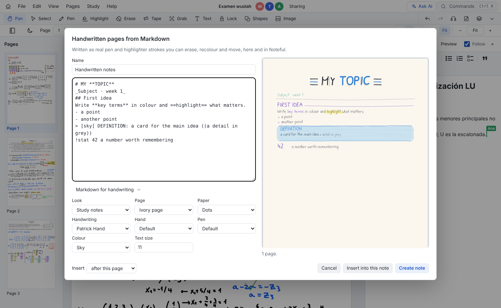</p>
<p align="center">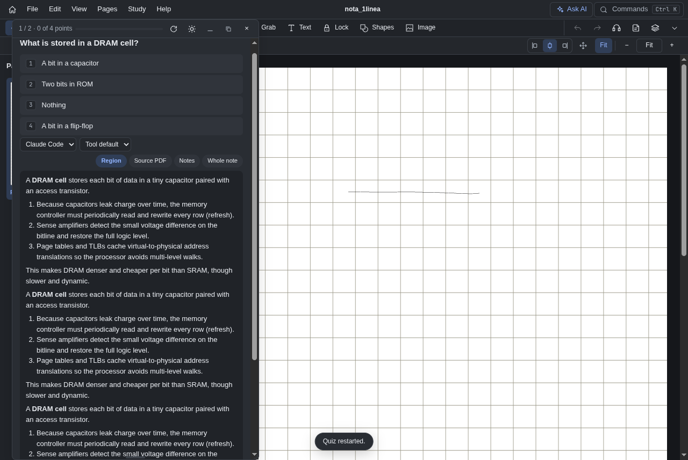 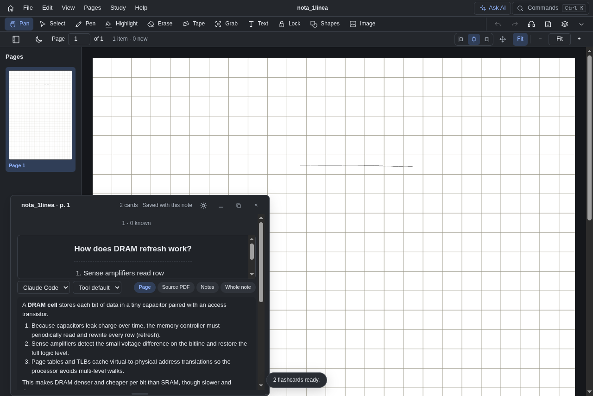</p>
<p align="center">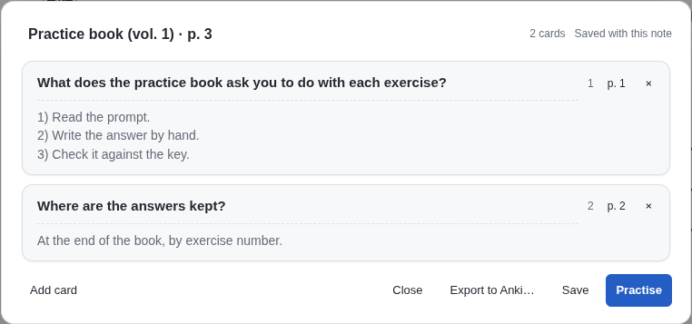</p>
<p align="center">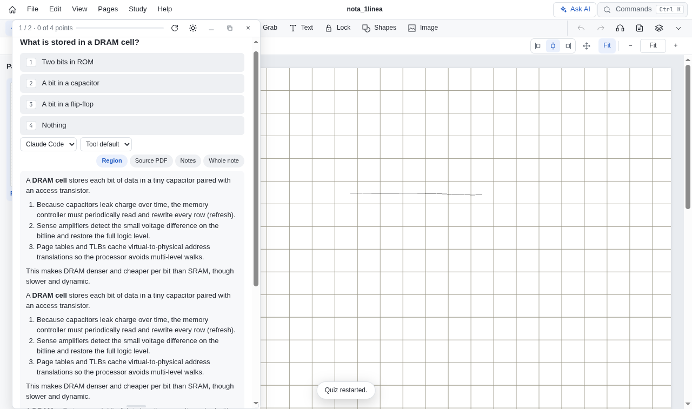</p>
<p align ="center">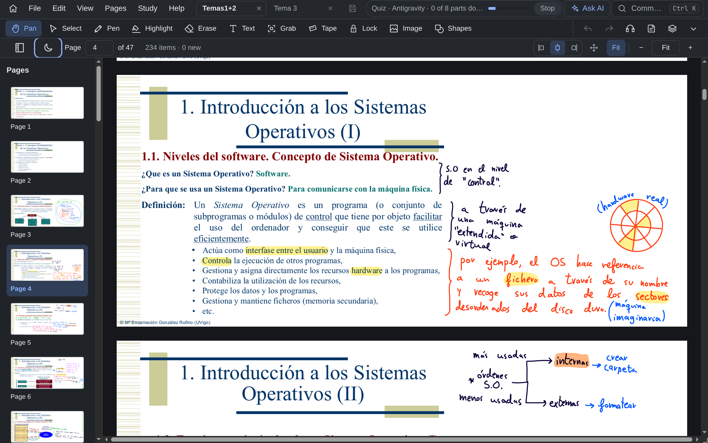

### Feels like a desktop app
- **Tabs and windows** (<kbd>Ctrl</kbd>+<kbd>T</kbd>); drag a tab out for its own window.
- **Floating windows** for Ask AI, audio, quizzes and flashcards: drag anywhere, resize from any edge, put away in a tray.
- **Narrow windows and phones**: two bottom bars; tools turn into icons before the toolbar wraps, and rows that still do not fit scroll sideways (mouse wheel too) with a faded edge, so every button stays reachable.
- **Updates**: checked on open, installed only when you agree.
- **Command search** (<kbd>Ctrl</kbd>+<kbd>K</kbd>), single-key shortcuts, and <kbd>?</kbd> to show each button's key.
- **Interface size** with <kbd>Ctrl</kbd>+<kbd>Shift</kbd>+<kbd>−</kbd> / <kbd>+</kbd> / <kbd>0</kbd>.

<p align="center">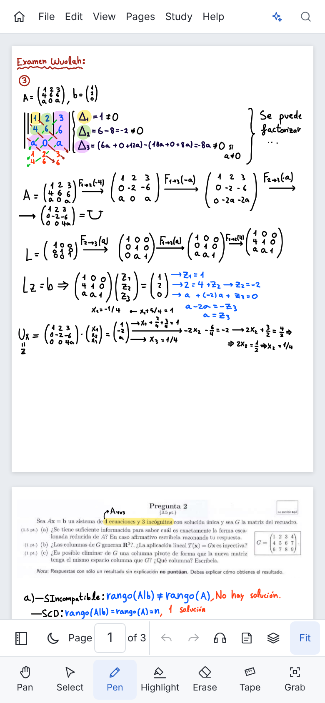</p>

<p align="center">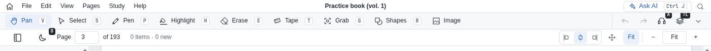</p>

**Private by default**: everything is processed locally. Drive access is read-only unless you choose to upload or delete. AI features use your own tools and send only what you choose (by default the current page); only Gemini transcription sends audio off the device.

Screenshots use the sample notes in [`samples/`](samples/).

## Get it

**Installers.** The [Releases page](https://github.com/Emefedez/NoteComplete/releases) has Linux AppImages (x86-64 and ARM64), macOS DMG/ZIP (Apple Silicon and Intel), a Windows installer and an Android APK preview, with SHA-256 checksums. A release is published automatically whenever the version on `main` changes; the desktop app offers it as an update. Builds are unsigned previews; Linux is the tested platform for now. See [builds](docs/BUILDS.md).

**Browser, iPhone and iPad.** Open the [web app](https://emefedez.github.io/NoteComplete/), published from `main` on every push, and install it if you like: on iPhone and iPad, Safari's Share → *Add to Home Screen*; on Android and computers, the browser's *Install*. It works offline once loaded, with tabs like the desktop app. To host it yourself, build it (below) and serve `apps/reader/`.

### Notes from Noteful on an iPad

1. In Noteful, back up or export your notebooks to a Google Drive folder (or copy `.noteful` files to your computer any other way).
2. In NoteComplete choose **Connect Google Drive** on Home, allow read-only access, and open that folder. Or use **File → Open…** for a local note, project, PDF or image.
3. Save your work as a NoteComplete project (`.nfedit`: the untouched original and every edit with its undo history), or as `.noteful` to take it back to the iPad (experimental: modified exports have not yet been verified in Noteful itself). **File → Export** makes a `.notecomp` (the note, its notes and added recordings in one file, to send) or Noteful + Markdown; see [file formats](#file-formats).

AI agents (MCP): [docs/MCP.md](docs/MCP.md). Drive setup for self-hosted builds (OAuth client, API key for public folder links) is in [Google Drive](docs/GOOGLE_DRIVE.md). Controls, audio and quality settings are in the [user guide](docs/USER_GUIDE.md).

## File formats

A note is **saved** in one of two formats; the others are **exports**.

| Format | What it holds | Use it for |
| --- | --- | --- |
| `.nfedit` (NoteComplete project) | The untouched original, every edit with undo and redo, the Markdown notes and the text of the handwriting ([spec](spec/nfedit-v1.md)) | Saving your notes in NoteComplete; new notes and canvases default to it |
| `.noteful` | Noteful's own format: pages, ink, PDFs, images, text | Notes you also open in Noteful on the iPad (experimental after editing) |
| `.notecomp` (export) | A tar archive: the note as a Noteful file, its Markdown notes, recordings added in NoteComplete, and the text of handwriting ([layout](spec/nfedit-v1.md#notecomp-archives)) | Sending a note with everything in one file |
| Noteful + Markdown (export) | The `.noteful` and its notes as a `.md` file, page breaks marked | Reading the notes anywhere |

`.notecomp` and `.notepart` files keep opening. Why the project and the package both exist: [docs/FILE-FORMATS.md](docs/FILE-FORMATS.md).

## Known issues

- Exports to `.noteful` after editing, crops made in NoteComplete included, have not yet been verified in Noteful itself.
- Releases are published automatically from 1.1.0 on; earlier local builds (1.0.x) find them as updates (Help → Check for updates… checks at once).
- Sharing and the drawing tablet are tested in Node and headless Chromium; real phones, tablets and styluses are being tried now. Safari does not give web pages the Apple Pencil Pro squeeze or double-tap, so on iPad the quick menu opens with two fingers held still.
- Uploading a change to Google Drive and deleting a note there are tested against a fake server only.
- A tab dragged out of the tab strip opens in its own window, but cannot be dropped onto another window's strip: Wayland does not tell the app where the pointer is outside its own windows.
- The Google Drive sign-in is not remembered between sessions, so Recent can only check Drive for newer versions after you connect (or for a public folder with an API key).
- Installers are unsigned previews, and Linux is the only tested platform.
- Every request and its state (`[D]` done, `[!]` not yet verified, `[ ]` to do) is in [docs/REQUESTS.md](docs/REQUESTS.md).

## Roadmap

Planned, not started (details in [docs/REQUESTS.md](docs/REQUESTS.md)):
- **The open NoteComplete format**: today `.notecomp` is a tar archive holding the native note, its Markdown notes, recordings added in NoteComplete and the text of handwriting written from Markdown ([layout](spec/nfedit-v1.md#notecomp-archives)); `.notepart` is still written the same way. The plan: study material (flashcards, quizzes) in the package too, `.notepart` as a partial patch for another copy of a note, and the format chosen on first save for every note (New document already asks). Files saved today keep opening: they are recognised by content.
- **Choose which pages to export**: this page, a range, a list or every page, for SVG, PDF and images.
- **Repositories** as a library source next to Google Drive: GitHub repositories with notes, files and solved exams, browsed from Home.

## Build from source

Requirements: Rust 1.93+, Node 22.13+ and Python 3.11+.

```sh
rustup target add wasm32-unknown-unknown
cargo install wasm-bindgen-cli --version 0.2.128 --locked --root work/wasm-tools
python3 tools/build_web.py
node tools/serve_web.mjs 8767          # http://127.0.0.1:8767/
```

Desktop: `cd apps/desktop && npm ci && npm run stage && npm start` (or `npm run dist` for a package). Mobile (Expo Go, SDK 57): `cd apps/mobile && npm ci && npm start`. Package workflows and signing limits: [builds](docs/BUILDS.md).

Checks:

```sh
cargo fmt --all --check && cargo clippy --workspace --all-targets --locked -- -D warnings
cargo test --workspace --locked
node --test apps/reader/*.test.mjs apps/mobile/*.test.mjs apps/desktop/*.test.mjs tools/*.test.mjs
node apps/reader/test.mjs              # after a web build
```

## How it reads Noteful files

Noteful's format is undocumented. NoteComplete's Rust core comes from the noteful-re reverse-engineering effort. Its tools and evidence (Ghidra scripts, the independent Python oracle, the legacy viewer and the parity checks) are kept on the [`reverse-engineering`](https://github.com/Emefedez/noteful-re/tree/reverse-engineering) branch of this repository, where a short writeup of how the format was worked out will be published. The resulting [format specification](spec/noteful-v0.1.md) is kept here.

Related work: [noteful-mcp](https://github.com/openninoor/noteful-mcp) (MIT) independently reads and writes Noteful notebooks for AI agents.

## Repository

| Directory | Purpose |
|---|---|
| `apps/reader/` | The NoteComplete app (web, and the UI of every build) |
| `apps/desktop/`, `apps/mobile/` | Electron desktop shell and Expo wrapper |
| `crates/` | Rust core (format, scene, editing, export), CLI and WASM adapter |
| `docs/` | User guide, Google Drive, builds, release notes |
| `spec/`, `samples/`, `tests/fixtures/` | Format specification the core implements, sample corpus and synthetic fixtures |
| `tools/` | Web build, local server and Expo helpers |
| `skills/` | Claude Code skills that came out of this project ([polished-apps](skills/polished-apps/SKILL.md): how apps like this one are built) |

Development procedure and architecture: [DEVELOPMENT.md](DEVELOPMENT.md).
