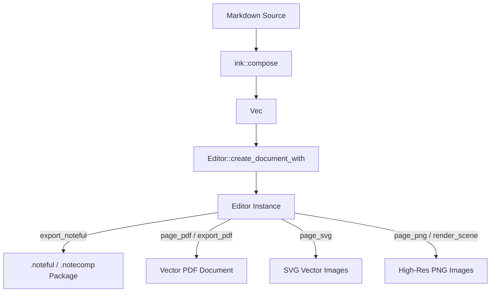

# Writing real Noteful ink from Markdown

Design and implementation plan for turning Markdown, SVG and page designs into editable
Noteful handwriting, and for annotating existing pages, inside NoteComplete's Rust core.

Status: **design, not implemented**. No code in this document has been written yet.
Reference implementation studied: [`openninoor/noteful-mcp`](https://github.com/openninoor/noteful-mcp) (MIT).

---

## 1. What this adds

NoteComplete today can open, edit and export `.noteful` files, and its MCP server can read a
notebook and write Markdown notes beside it. It cannot *write ink*. This plan adds:

| Capability | Result in Noteful |
|---|---|
| Markdown → notebook | New pages whose text is real, editable handwriting strokes |
| Markdown → existing notebook | New pages inserted at the end or after page N |
| Annotate an existing page | Text, ticks, circles, arrows, highlights, tape over existing ink |
| Study look | Titles, cards, columns, colour zones, sticky notes, stats, tree diagrams |
| SVG → ink | Diagrams drawn as pen and highlighter strokes, not pasted images |
| Native text boxes | First-class kind-2 Noteful text objects (multi-run rich text, alignment, wrapping, edit imported text) |
| Copy a page design | Layout read from a mockup picture and rewritten in ink |
| In-app conversion | Markdown/`.md` → `.noteful`, then existing export to PDF, PNG, SVG |

Everything is produced as ordinary pen, highlighter and tape strokes, or native Noteful typed
text boxes. The result stays editable on the iPad: the user can erase it, recolour it,
lasso it, re-type text, and move it.

Non-goals for the first release:

- OCR or handwriting recognition (handwriting is stored as vector ink strokes, not OCR text).
- Writing into a live iCloud library. NoteComplete has no macOS/Noteful-for-Mac bridge; it
  writes files. MCP tools therefore write **copies**, never the open note.
- Reproducing Noteful's exact pen engine. We reproduce the *wire format* faithfully and
  approximate the hand.

---

## 2. Version baseline (verified 2026-10-31)

This matters because the reference project is a beta and its format target differs from the
files in `samples/`.

### 2.1 The reference snapshot is current

| Item | Value |
|---|---|
| Local snapshot | `work/noteful-mcp-ref` (shallow clone) |
| Local HEAD | `175e8d7c5389a9505d0b9fca9082e69b0179b648` |
| HEAD date | 2026-10-26 21:03:10 +03:00 |
| HEAD commit subject | `Read text files as UTF-8 on every platform` |
| GitHub `main` HEAD on 2026-10-31 | `175e8d7c5389a9505d0b9fca9082e69b0179b648` (verified via `git ls-remote`) |
| Git release tag `v1.0.0b1` | `0d002525884115c707117f4af9a7c538759d9eed` (2026-10-26 20:30 +03:00) |
| Relation to release tag | Local HEAD is **1 commit ahead** of `v1.0.0b1` (UTF-8 fix for Windows font loading) |
| Upstream `pyproject.toml` version | `1.0.0b1` |
| Repository history | 15 commits, all 2026-10-25/26 |

Conclusion: the downloaded copy **is** the latest GitHub build and matches GitHub `main` HEAD byte-for-byte. It is one commit ahead of the tagged release `v1.0.0b1` (`0d00252`), incorporating the critical cross-platform UTF-8 file reading fix for SVG fonts. There are no uncommitted changes or divergent branches.

Two caveats:

- The clone is **shallow** (`git rev-parse --is-shallow-repository` → `true`). Before relying
  on it again, run `git fetch --depth=20 origin main` and compare `git rev-parse HEAD`.
- Pin the **commit** (`175e8d7`), not the tag or version. `1.0.0b1` is a single beta tag covering all 15 commits;
  anyone who cloned before `cf3748e` (pressure variation) or `e8008b6` (design tools) has the
  same version number in `pyproject.toml` but a different feature set.

### 2.2 Format versions do not match

Three different package versions are in play:

| Source | Index tag 1 (`f32`) | Notes |
|---|---|---|
| `noteful-mcp` writer | **1.2** | `container.py`: "package format version (1.2)"; README targets Noteful 1.4.x |
| NoteComplete samples | **1.19 / 1.21** | `samples/*.noteful`, saved by a recent Noteful |
| NoteComplete `Editor::create_document` | **1.0** | `imports.rs` writes `f(1, 3, V::Float(1.))` |

Our reader accepts all of them, but **we have never verified that Noteful imports a file we
wrote**, and upstream does not claim support for 1.21. Treat this as the first implementation
gate, not an assumption.

Decisions:

1. **Editing an existing file preserves its version.** `export_noteful` already keeps the
   source index; do not rewrite tag 1.
2. **New files get an explicit version.** Add `DocumentOptions::format_version`; keep `1.0`
   as the default until the compatibility spike (Phase 0) says otherwise, then change the
   default to whichever version Noteful accepts. `1.2` is the leading candidate because it is
   the only version with field reports from upstream users.
3. **Never emit a version we have not tested.** The spike matrix is `1.0`, `1.2`, `1.19`,
   `1.21` × paper strategy.

### 2.3 What is portable from the reference

The reference is Python 3.12 with NumPy/Pillow/PyMuPDF. We are **not** shipping it as a
sidecar and not translating it line for line. We port:

- the byte layout of ink (already decoded in `stroke.rs`; writing is new),
- glyph outlines and the handwriting model (pure geometry),
- the Markdown dialect and layout rules,
- the SVG→ink rules,
- the study themes,
- shapes, highlighter and tape geometry.

Fonts are SIL Open Font License 1.1 (`OFL.txt`, `OFL-PatrickHand.txt`, `OFL-Caveat.txt`);
they are redistributable with attribution. Upstream code is MIT; keep its copyright notice in
a `NOTICE`/module header when algorithms are ported.

---

## 3. Where we are, and the gap

| Feature | NoteComplete today | `noteful-mcp` 175e8d7 |
|---|---|---|
| New notebook from Markdown | No (MCP writes `.md` notes only) | `create_notebook` |
| Add handwritten pages | No | `add_pages`, `clean_copy` |
| Annotate existing page | Editor UI can, API only `add_line` | `write_on_page` (13 item types) |
| Pressure strokes | Decodes them; **writes constant width** | Writes per-point pressure |
| Highlighter under ink | Decodes/render order; additions append on top | `under` stroke list |
| Handwriting fonts | None | 7 SVG fonts, 3 hand presets |
| Greek/math glyphs | None | 35 hand-drawn extras + super/subscript |
| Study look | None | Themes, cards, columns, zones, sticky, stats, maps |
| SVG → ink | None | `svgink` (shapes, paths, text, pastel fills) |
| Copy a page design | None | `design_mockup`, `mockup_grid`, `design_page` |
| Raster trace | None | `trace.py` (needs NumPy/OpenCV-ish extras) |
| Live library | No | Yes (macOS) |
| PDF export | Yes (`page_pdf`) | Yes |

The wire-format foundation is in place:

- `Editor::create_document` builds a valid package (title block, document block, page records).
- `Editor::insert_pages` inserts pages with an optional PDF background.
- `Editor::add_line` + `export_noteful` appends strokes and rewrites the page's editable layer.
- `Stroke` already decodes per-point radii, pressure flag, eraser mask and tape flag.
- `scene.rs` already renders variable-width strokes.

The missing pieces are (a) pressure on write, (b) an ordering path for under-ink strokes,
(c) geometry/fonts/layout, (d) MCP contracts.

---

## 4. Architecture

### 4.1 Module layout

New code lives in the core so the desktop app, CLI and WASM all get it:

```
crates/noteful-core/src/ink/
    mod.rs        public options, page specs, composition entry points
    font.rs       SVG font parser -> Font/Glyph, cached
    glyphs.rs     Greek/math extras, fallbacks, super/subscript scripts
    hand.rs       Pen, TextStyle, noise, resample, pressure, text and shapes
    compose.rs    Markdown -> PageSpec (pagination, columns, directives)
    study.rs      study themes and block renderers
    svg.rs        SVG document -> strokes + under-strokes
    paper.rs      generated paper PDF (blank/dot/grid/ruled, light/dark)
    design.rs     optional: mockup spec -> strokes (feature "design")
crates/noteful-core/assets/fonts/
    PatrickHandLine.svg, CaveatLine.svg, PatrickHandBlock.svg,
    EMS*.svg, OFL*.txt
crates/noteful-cli/src/mcp.rs        new write tools (Phase 6)
crates/noteful-cli/src/mockup.rs     optional image grid / image model (Phase 7)
crates/noteful-wasm/src/lib.rs       create_handwritten_document (Phase 8)
docs/MCP.md                          user-facing tool docs (Phase 6)
```

`noteful-core` is `#![forbid(unsafe_code)]` and deliberately has no filesystem, UI, network or
platform APIs. Keep it that way:

- Fonts are embedded with `include_str!`; no runtime file access.
- Paper PDFs and SVG parsing are pure computation.
- The optional image model (`design_mockup`) and PNG grid overlay live in the CLI, not in core.
- Raster tracing is a Cargo feature (`design`) enabled for native builds and **off** for WASM.

### 4.2 New dependencies

| Crate | Use | Size/risk |
|---|---|---|
| `roxmltree` | Parse SVG fonts and SVG drawings | small, pure Rust |
| `svgtypes` | Path data parser (`M L C Q A Z`, relative forms) | small, pure Rust |
| `rand` + `rand_chacha` | Deterministic seeded hand jitter | small; `ChaCha8Rng` is reproducible |
| `image` | Optional: decode mockups, encode grid PNG, raster trace | medium; **CLI/native only** |
| `ureq` | Optional: call the image model for `design_mockup` | CLI only, behind `design-ai` feature |

No PDF crate is needed for paper: `pdf-writer` is already a dependency and can produce vector
pages. A textured/grain paper would need JPEG encoding; skip texture in v1 and use vector
paper (ivory/black fill + dots/lines), which is what a reader sees at normal zoom.

### 4.3 Data-model changes

#### `Line` gains pressure

```rust
pub struct Line {
    pub points: Vec<[f64; 2]>,
    pub width: f64,
    pub rgba: [f64; 4],
    #[serde(default)]
    pub tool: u16,
    #[serde(default)]
    pub layer: u32,
    #[serde(default, skip_serializing_if = "Option::is_none")]
    pub shape: Option<crate::Shape>,
    #[serde(default, skip_serializing_if = "std::ops::Not::not")]
    pub square: bool,
    /// Pen pressure per point, 0..=1, same length as `points`.
    /// Present only for ballpoint-style strokes; fineliners and highlighters omit it.
    #[serde(default, skip_serializing_if = "Option::is_none")]
    pub pressure: Option<Vec<f32>>,
}
```

Rules:

- Ballpoint: `pressure` present, `width` is the nominal thickness (exported as half-width) and
  is ignored by Noteful's renderer; actual thickness ≈ `2.1 × pressure`.
- Fineliner: `pressure` absent, `width` is the full thickness; Noteful draws `2 × (width / 2)`.
- Highlighter (`tool == 1`): never pressure; `width` is the full band height.
- Tape (`tool == 2`): never pressure; `width` is the full strip width.
- `add_line` rejects `pressure.len() != points.len()`, non-finite values, or values outside
  `0..=1`. Existing `points <= 8192` and width limits stay.

#### Under-ink ordering

Highlights must be drawn before the ink they mark. Put the hint on the line rather than on
`Edit::Add`, so the edit enum (which uses `deny_unknown_fields`) does not change:

```rust
pub struct Line {
    // ...
    /// Draw below the page's other ink. Set by `add_line_under`; highlighter fills only.
    #[serde(default, skip_serializing_if = "std::ops::Not::not")]
    pub under: bool,
}
```

`Line` does not use `deny_unknown_fields`, so older `.nfedit` readers ignore the new field and
newer readers default it to `false`. Public API:

```rust
pub fn add_line(&mut self, page: usize, line: Line) -> Result<()>;          // unchanged
pub fn add_line_under(&mut self, page: usize, line: Line) -> Result<()>;    // sets under
pub fn add_lines(&mut self, page: usize, lines: Vec<Line>) -> Result<()>;   // one undo step
```

Export partition, per page:

1. under-additions, in insertion order;
2. existing decoded strokes (when inserting into a file);
3. normal additions, in insertion order.

Why not rely on the stroke's `z` header? We do not know whether Noteful sorts by it; upstream
does not, and its rendering matches the app by stream order. Do not invent semantics.

When under-additions exist on a page with existing ink, `export_noteful` must **prepend** a
style record + under strokes before the existing blob, then keep the existing blob and append
the rest. When there are none, keep today's append-only path so untouched ink stays
byte-identical. This is the only place that rewrites existing ink bytes; guard it with a
round-trip test.

#### Pressure encoding in `new_stroke`

```
[f1 01][id u64][flags u16][clock u64][clock2 u64][z u64]
[layer u32][radius f64][0 u32][count u32]
n <= 4:  n × (x f32, y f32[, pressure f32])
n >= 5:  for each dimension: (min f32, range f32)
         then n × (x u16, y u16[, pressure u16])
```

`flags` bit 0 = pressure present. With pressure, `radius` is still written (use `width / 2`)
but ignored by the app. Normalise pressure with the same min/range scheme; an all-equal
pressure column encodes as `range = 0` and zeros, which decodes to the minimum — acceptable,
but avoid it by never emitting a flat pressure profile for a ballpoint.

#### Preview and export

- `scene::line_svg` currently takes one radius. Add `line_svg_variable(points, radii, rgba)`:
  emit a filled variable-width ribbon, or circles at each point when the segment is short.
  Use the same helper for SVG export so the desktop preview and exported SVG agree.
- Decoded strokes already use circles per point (`stroke_svg`/`run_svg`). Leave that path
  alone for now; a ribbon is a later quality improvement.
- `Editor::additions()` order is preserved; the preview already draws additions after
  existing items, so under-additions will preview on top unless the scene layer also
  partitions. Add the same partition in `scene.rs` so preview matches export.

#### Document creation options

```rust
pub enum PaperStyle {
    Blank,
    Dotted { spacing: f64 },
    Grid { spacing: f64 },
    Ruled { spacing: f64 },
    Dark(Box<PaperStyle>),          // black page, light pattern
    Json(PaperTemplate),            // Noteful's own JSON template (pc/lt/lh/lw)
    Pdf { id: String },             // caller-supplied background
}

pub struct DocumentOptions {
    pub title: String,
    pub sizes: Vec<[f64; 2]>,
    pub pdf: Vec<u8>,
    pub paper: PaperStyle,
    pub format_version: f32,
    pub created: Option<i64>,   // Apple epoch µs; None = now
}

pub fn create_document_with(options: &DocumentOptions) -> Result<Self>;
pub fn create_document(title: &str, sizes: &[[f64; 2]], pdf: &[u8]) -> Result<Self>; // wrapper
```

`NewPage` gains `paper: Option<PaperStyle>` so `insert_pages` can give inserted pages a paper
background. The generated paper PDF is added as one `NewPdf` resource with one page per
distinct style, matching the upstream approach (one PDF, `tag 3` = style index).

### 4.4 Paper strategy

Two mechanisms exist:

- **JSON paper** (`background tag 0 = 2`, `tag 6` a JSON string):
  `{"pc":16777215,"lt":2,"lh":24,"lw":0.5,...}` for grid, `{"lh":16,...}` for ruled,
  `{"pc":...}` for blank. This is what Noteful itself stores, it is tiny and editable.
  Our `create_document` writes `{"pc":16777215}` with `tag 0 = 0`.
- **PDF paper** (`background tag 0 = 1`, `tag 3` = page index, `tag 4` = file id): what
  `noteful-mcp` writes. Proven to import, supports dark pages and texture, costs a PDF.

Plan:

1. Implement `paper.rs` to generate vector PDFs for blank/dot/grid/ruled, light and dark,
   A4 at 595.28 × 841.89 pt.
2. Make **PDF paper the default for new notebooks**, because it is the only path with field
   reports.
3. Keep JSON paper as `PaperStyle::Json` for small files and spike it; switch the default if
   it imports reliably (it would make files much smaller and let Noteful restyle them).
4. Never mix: a page has one background record.

### 4.5 Font pipeline

`font.rs` parses SVG fonts (`<font-face>`, `<missing-glyph>`, `<glyph unicode d horiz-adv-x>`):

```rust
pub struct Font {
    pub name: String,
    pub units_per_em: f64,
    pub ascent: f64,
    pub descent: f64,
    pub x_height: f64,
    pub glyphs: HashMap<char, Glyph>,
}
pub struct Glyph { pub advance: f64, pub contours: Vec<Vec<[f64; 2]>> }

pub fn load(font: FontChoice) -> &'static Font;   // LazyLock cache
```

Font choices and intended use:

| Key | File | Use |
|---|---|---|
| `patrick` | `PatrickHandLine.svg` | default body and titles |
| `caveat` | `CaveatLine.svg` | cursive accents, alternate body |
| `block` | `PatrickHandBlock.svg` | caps headings without faking small caps |
| `readability` | `EMSReadability.svg` | very legible |
| `felix`, `allure`, `elfin`, `nixish` | `EMS*.svg` | styles offered to agents |

Path parsing: implement a flattener over `svgtypes::PathParser` supporting `M m L l H h V v
C c S s Q q T t A a Z z`. Convert arcs to cubics, adaptively flatten to ≤ 0.6 page-unit
segments, then resample.

Shaping (`hand.rs`):

- `TextStyle { font, size (x-height in page units), slant, letter_jitter, baseline_drift,
  tracking, line_height, distortion }`.
- Hands: `neat` (0.05/0.04/0.05/0.03), `natural` (0.10/0.08/0.10/0.07), `messy`
  (0.15/0.14/0.20/0.12) for slant/jitter/drift/distortion.
- Per glyph: shear by slant, jitter x/y, apply low-frequency value-noise distortion to
  contour points, rotate slightly around the baseline, advance by `advance × tracking`.
- Fallbacks: substitute `− – ’ ‘ …`, try NFD base letter (so `é` uses `e`), then
  `glyphs.rs` extras, then `missing-glyph`, then skip with a warning.
- Scripts: superscript/subscript are marked with private sentinels by `glyphs::scripts`,
  then written at 0.62× size with a raised/lowered baseline.
- `write_line`, `write_block` (wrapping by measured width), `text_width`.
- Shapes: `line`, `arrow`, `rect(radius)`, `ellipse`, `underline(double)`, `checkmark`,
  `star`, `divider`, `highlight_line`, `highlight_rect`, native `tape_strip`.
- Pen: `width`, `pressure`, `fineliner`, `seed`; `stroke(points, step, smoothing, tremor)`.
  Resample at ~2.2 units, Chaikin smooth, add tremor noise, then:
  - fineliner → no pressure, `width = thickness × 1.05 / 2`;
  - ballpoint → pressure profile with ramp-in/ramp-out, scaled so
    `thickness = width × 1.3` and stored pressure ≈ `thickness / 2.1`.

Determinism: `ChaCha8Rng::seed_from_u64(seed)`; every page records its seed. Same seed and
inputs must produce byte-identical pages (test).

Glyph extras: port the 35 hand-drawn glyphs from `glyphs.py`:
`° ± × Δ Σ Φ Ω α β γ δ ε η θ λ μ π ρ σ τ φ ψ ω ∂ ∑ √ ∝ ∞ ∫ ≈ ≠ ≤ ≥`.
Also add the arrows the Markdown layer needs: `→ ← ⇄ ⇒`.

### 4.6 Composition and pagination

```rust
pub struct ComposeOptions {
    pub paper: PaperStyle,
    pub ink: Rgba,
    pub accent: Accent,
    pub font: FontChoice,
    pub size: f64,
    pub hand: Hand,
    pub pen: PenKind,
    pub look: Look,          // Classic | Study
    pub theme: Theme,        // Light | Dark
    pub seed: u64,
}
pub struct PageSpec {
    pub lines: Vec<Line>,        // normal ink
    pub under: Vec<Line>,        // highlighter / fills
    pub images: Vec<ImageSpec>,  // reserved; v1 emits none
    pub paper: PaperStyle,
    pub warnings: Vec<String>,   // "text overlaps at ...", "unsupported SVG ..."
}
pub fn compose(markdown: &str, options: &ComposeOptions) -> Result<Vec<PageSpec>>;
```

`Composer` keeps `x0/x1/y`, a column stack, and a pagination callback. Blocks are measured
before drawing so a block that does not fit moves to the next page; `\pagebreak` forces a
break. A page is A4 (`1091.34 × 1543.46`), margins ~86 units, baseline grid from the paper
style. `!columns` pushes a column context; each column is a nested composer with its own
cursor and page-height budget; the outer page height is the max of the columns.

Warnings are returned to the agent (and shown in the app) rather than failing: overlapping
text and unsupported SVG features are recoverable.

### 4.7 Study look

Port the two themes and block renderers:

- Light: ink `#1f2233`, grey `#6b6f80`, shadow `#d9cfc0`, accents coral/amber/sky/purple/
  teal/pink.
- Dark: ink `#f4f1ea`, grey `#a3a3ad`, shadow `#3a3a40`, neon accents.

Blocks:

- **Title**: block capitals, optional `**word**` in accent colour, offset shadow strokes,
  stripe bars; `# A // B` for a two-line title on a marker band; `:icon:` doodles
  (heart, sun, star, atom, drop, bolt, cloud, leaf) drawn as strokes.
- **Subtitle**: `_text_`, with a thin rule.
- **Heading (##)**: caps on a rule to the page edge, accent rotates per section, max 3
  accents per page.
- **Label (###)**: small caps.
- **Body**: mixed case, felt-tip (fineliner) by default, `**bold**` in accent,
  `==highlight==` under-ink, `[[tag]]` pill, `((detail))` grey.
- **Cards**: `> [sky] TITLE: text`; fills are highlighter bands, outlines are sketched rects;
  `>> A: ... || B: ...` lays two cards side by side.
- **Columns**: `!columns [60]`, `!col`, `!end`.
- **Zone**: `!zone [sky]` … `!end`, full-width pale band behind the content, drawn under.
- **Sticky**: `!sticky [yellow] TITLE: text`, taped, slightly rotated.
- **Stat**: `!stat 30 reflected (albedo)`, big coloured number and label.
- **Map**: `!map TOPIC | question?` then indented `- BRANCH` / `  - leaf`; draws a tree with
  sketched connectors.
- **Rule**: `---`.
- **Draw**: `!draw [width] <svg>…</svg> !end`; delegates to `svg.rs`.

Do not reproduce the rejected style patterns documented upstream (bubble titles, all-caps
body, a colour per section, pill clutter, stacked full-width boxes).

### 4.8 Touch points in existing files

| File | Change |
|---|---|
| `crates/noteful-core/src/editor.rs` | `Line.pressure`, `Line.under`; `add_line` validates pressure; `add_line_under`, `add_lines`; `additions()` unchanged; replay of `Edit::Add` unchanged |
| `crates/noteful-core/src/export.rs` | `new_stroke` emits 3-value pressure points and `flags = 1`; per-page stable partition; prepend path for under strokes; `create_document` wrapper |
| `crates/noteful-core/src/scene.rs` | Preview partition (under first); `line_svg` variable width for `Line.pressure`; page previews unchanged for decoded strokes |
| `crates/noteful-core/src/imports.rs` | `DocumentOptions`, `create_document_with`, paper PDF block, `format_version`, page record `tag 0 = 1` for PDF paper |
| `crates/noteful-core/src/pages.rs` | `NewPage.paper: Option<PaperStyle>`; `blank_page` writes the paper background |
| `crates/noteful-core/src/manipulation.rs` | `adjusted_line` scales pressures with width (otherwise moving/resizing changes apparent thickness) |
| `crates/noteful-core/src/lib.rs` | `pub mod ink`, re-export `PaperStyle`, `ComposeOptions`, `compose` |
| `crates/noteful-core/Cargo.toml` | `roxmltree`, `svgtypes`, `rand`, `rand_chacha`; optional `image`, `ureq` |
| `crates/noteful-cli/src/mcp.rs` | New tools, schemas, resources, prompts, `page_layout` |
| `crates/noteful-cli/Cargo.toml` | `image` (PNG grid), optional `ureq` |
| `crates/noteful-wasm/src/lib.rs` | `compose_markdown`, `create_handwritten_document` |
| `docs/MCP.md` | Write tools, output folder, safety, examples |
| `spec/noteful-v0.1.md` | Phase 0 compatibility results |

`manipulation.rs` detail: if `a.width` is set and `line.pressure` is present, scale each
pressure by `new_width / old_width` and clamp to `0..=1`; if the line has no pressure, keep
today's width-only behaviour. Point transforms and colours are unchanged.

---

## 5. Markdown dialect

One block per line. This is a superset of CommonMark chosen for handwriting layout, not a
CommonMark parser.

| Input | Result |
|---|---|
| `# TITLE` | study title (caps, shadow, accent word with `**`) |
| `# A // B` | two-line title, second line on a marker band |
| `_subtitle_` | subtitle + rule |
| `## Section` | section heading |
| `### Label` | small label |
| plain line | body paragraph |
| `**term**` | accent-coloured term |
| `==phrase==` | highlighter under the phrase |
| `[[tag]]` | pill |
| `((detail))` | grey secondary text |
| `- item`, `* item`, `1. item` | dot / star / circled-number item |
| `-> item` | arrow item |
| `[ ] item`, `[x] item` | empty / ticked checkbox |
| `> [sky] TITLE: text` | card |
| `>> A: text \|\| B: text` | two cards side by side |
| `!columns [60]`, `!col`, `!end` | columns |
| `!zone [sky]`, `!end` | colour zone |
| `!sticky [yellow] TITLE: text` | sticky note |
| `!stat 30 label` | statistic |
| `!map TOPIC \| question?` | tree diagram |
| `!draw [width] <svg>…</svg> !end` | SVG diagram |
| `!tape [mint]` | tape strip over the next block |
| `---` | thin rule |
| `\pagebreak` | forced page break |
| `{color:red} text` | explicit line colour |

Science: Greek letters, `T^4`, `m^{-2}`, `CO_2`, `→ ⇄ ≈ ± °` are all supported through
glyph fallbacks and scripts. `look: classic` uses a plain notebook layout (headings, bullets,
paragraphs) with none of the study decoration.

---

## 6. SVG → ink

```rust
pub struct Drawing { pub lines: Vec<Line>, pub under: Vec<Line>, pub warnings: Vec<String> }
pub fn drawing(svg: &str, frame: [f64; 4], pen: &Pen) -> Result<Drawing>;
```

Frame is `[x, y, width, height]` in page units; height defaults to width × viewBox aspect.

Supported:

| SVG | Ink |
|---|---|
| `rect`, `circle`, `ellipse`, `line`, `polyline`, `polygon` | pen outlines |
| `path` (M L H V C S Q T A Z, absolute and relative) | pen polylines |
| `g` with `transform` (translate/scale/rotate/matrix) | inherited transform |
| `viewBox`, `preserveAspectRatio` (default meet) | fitted to frame |
| `fill` (solid colour) | highlighter fill under the outline |
| `stroke`, `stroke-width`, `fill="none"` | pen colour and width |
| `text` | handwriting at `font-size`, mapped to the selected font |
| `style="fill:#...;stroke:#..."` on any element | parsed subset |

Approximated or rejected (with a warning, never silently wrong):

- gradients, patterns, filters, masks, clip paths — ignored;
- embedded `image`, `use`, `marker`, `textPath` — skipped;
- CSS stylesheets/classes — only inline `style` and presentation attributes;
- `stroke-dasharray` — drawn solid;
- opacity — mapped to the pen alpha;
- very large path counts — capped (see limits).

Pastel palette for fills: `#ffb48a #8fc3ff #c9b6ff #9fe3c4 #ffe066 #f4a3a3`, dark outline.

---

## 7. MCP tool contracts

Existing tools (`list_notes`, `note_outline`, `page_text`, `page_image`, `search_note`,
`extract_resource`, `read_notes`, `write_notes`, `write_anki_deck`) stay unchanged — the first
seven are read-only, the last two write Markdown notes and Anki decks. New tools follow the
same stdio JSON-RPC server in `crates/noteful-cli/src/mcp.rs`.

Parity with upstream:

| `noteful-mcp` | Here | Notes |
|---|---|---|
| `create_notebook` | `create_notebook` | same idea; no macOS delivery |
| `add_pages` | `add_pages` | copies the file |
| `clean_copy` | `clean_copy` | wrapper |
| `write_on_page` | `write_on_page` | highlights under existing ink |
| `page_layout` | `page_layout` | read-only aiming |
| `example_pages` | `example_pages` | bundled sources + previews |
| `design_mockup` / `mockup_grid` / `design_page` | same (Phase 7) | image model optional |
| `live_library`, `search_text`, `render_page`, `render_region`, `page_marks`, `export_pdf`, `extract_files` | not ported | our existing readers/exporters cover the local-file cases |
| `notebook_info`, `page_ink` | `note_outline` | equivalent data |
| `rename_notebook`, `output_folder` | not needed | `out` is explicit |

Safety rules for every write tool:

- Never overwrite the input. Write to `out`, or to `~/Documents/NoteComplete/ink/<title>.noteful`
  when `out` is omitted. `overwrite: true` is required to replace an existing output.
- With `in_place: true`, write `<name>.noteful` and keep `<name>.noteful.bak`; refuse for
  `.nfedit` projects unless the caller confirms.
- Validate every path, size, count and string length; return a tool error, not a panic.
- Return text plus a PNG of the first written page (reuse `page_png`), so the agent can check
  its work.

### 7.1 `create_notebook`

Generates a brand-new `.noteful` notebook containing handwritten pages synthesized from Markdown.

**Input Schema:**

```json
{
  "title": { "type": "string", "description": "Notebook title" },
  "markdown": { "type": "string", "description": "Markdown content using the handwriting dialect" },
  "paper": {
    "type": "string",
    "enum": ["dot", "grid", "ruled", "blank", "dark-dot", "dark-grid", "dark-ruled", "dark-blank"],
    "default": "dot",
    "description": "Background paper pattern and brightness"
  },
  "ink": {
    "type": "string",
    "default": "ink",
    "description": "Base ink color name or hex (#1f2233, #000000, #f4f1ea)"
  },
  "accent": {
    "type": "string",
    "enum": ["coral", "amber", "sky", "purple", "teal", "pink", "mint", "orange", "yellow"],
    "default": "sky",
    "description": "Primary accent color for headings, bold terms, cards, and diagrams"
  },
  "font": {
    "type": "string",
    "enum": ["patrick", "caveat", "block", "readability", "felix", "allure", "elfin", "nixish"],
    "default": "patrick",
    "description": "Handwriting font family"
  },
  "size": {
    "type": "number",
    "default": 11.0,
    "minimum": 6.0,
    "maximum": 36.0,
    "description": "Base body text size (x-height in page points)"
  },
  "seed": {
    "type": "integer",
    "description": "Random seed for reproducible natural jitter. Defaults to deterministic hash of title."
  },
  "hand": {
    "type": "string",
    "enum": ["neat", "natural", "messy"],
    "default": "natural",
    "description": "Jitter, slant, and baseline drift preset"
  },
  "pen": {
    "type": "string",
    "enum": ["fineliner", "ballpoint"],
    "default": "fineliner",
    "description": "Pen model (fineliner is uniform width; ballpoint emits pressure-varying strokes)"
  },
  "look": {
    "type": "string",
    "enum": ["study", "classic"],
    "default": "study",
    "description": "Layout style: 'study' adds cards, shadows, pill tags, zones; 'classic' is plain ruled notes"
  },
  "theme": {
    "type": "string",
    "enum": ["light", "dark"],
    "default": "light",
    "description": "Visual theme palette"
  },
  "out": {
    "type": "string",
    "description": "Destination file path. If omitted, writes to ~/Documents/NoteComplete/ink/<title>.noteful"
  },
  "overwrite": {
    "type": "boolean",
    "default": false,
    "description": "Allow replacing an existing file at destination"
  }
}
```
*Required properties:* `title`, `markdown`.

**Output Response:**

```json
{
  "content": [
    {
      "type": "text",
      "text": "Created notebook 'Cell biology' with 3 pages at /home/user/Documents/NoteComplete/ink/Cell biology.noteful"
    },
    {
      "type": "image",
      "mimeType": "image/png",
      "data": "<base64 encoded rendered PNG of page 1>"
    }
  ],
  "meta": {
    "path": "/home/user/Documents/NoteComplete/ink/Cell biology.noteful",
    "pages": 3,
    "warnings": []
  }
}
```

### 7.2 `add_pages`

Appends or inserts newly composed handwritten pages into an existing `.noteful` file.

**Input Schema:**

```json
{
  "path": { "type": "string", "description": "Path to the existing .noteful file" },
  "markdown": { "type": "string", "description": "Markdown to compose into new handwritten pages" },
  "after_page": {
    "type": "integer",
    "minimum": 0,
    "description": "1-based page index after which new pages are inserted (0 = at beginning; omit for end of note)"
  },
  "paper": { "type": "string", "enum": ["inherit", "dot", "grid", "ruled", "blank", "dark-dot", "dark-grid", "dark-ruled", "dark-blank"], "default": "inherit" },
  "font": { "type": "string", "default": "patrick" },
  "hand": { "type": "string", "default": "natural" },
  "pen": { "type": "string", "default": "fineliner" },
  "look": { "type": "string", "default": "study" },
  "theme": { "type": "string", "default": "light" },
  "accent": { "type": "string", "default": "sky" },
  "seed": { "type": "integer" },
  "out": { "type": "string", "description": "Destination file path (copies by default; requires in_place to modify input)" },
  "in_place": { "type": "boolean", "default": false, "description": "Replace source file, creating a <path>.bak backup" }
}
```
*Required properties:* `path`, `markdown`.

### 7.3 `clean_copy`

A streamlined helper for study workflows: takes messy notes or raw lecture notes, reformats them cleanly onto ruled or dotted study pages, and inserts them right after the original page.

**Input Schema:**

```json
{
  "path": { "type": "string", "description": "Source .noteful file" },
  "page": { "type": "integer", "minimum": 1, "description": "Page number to clean copy (new pages inserted immediately after)" },
  "markdown": { "type": "string", "description": "Cleaned up Markdown text to write" },
  "hand": { "type": "string", "enum": ["neat", "natural"], "default": "neat" },
  "paper": { "type": "string", "default": "ruled" },
  "look": { "type": "string", "default": "study" },
  "out": { "type": "string" },
  "in_place": { "type": "boolean", "default": false }
}
```
*Required properties:* `path`, `page`, `markdown`.

### 7.4 `write_on_page`

Annotates an existing page in a `.noteful` file with ink items (text, corrections, checkmarks, arrows, shapes, highlighter bands, tape, SVG drawings).

**Input Schema:**

```json
{
  "path": { "type": "string", "description": "Path to source .noteful notebook" },
  "page": { "type": "integer", "minimum": 1, "description": "1-based page number to annotate" },
  "items": {
    "type": "array",
    "description": "List of annotation items to place on the page",
    "items": {
      "type": "object",
      "properties": {
        "type": {
          "type": "string",
          "enum": ["text", "markdown", "textbox", "line", "arrow", "rect", "ellipse", "underline", "check", "star", "highlight", "highlight_line", "tape", "drawing"]
        },
        "x": { "type": "number", "description": "X coordinate in page points (origin top-left, A4 width = 1091)" },
        "y": { "type": "number", "description": "Y coordinate in page points (A4 height = 1543)" },
        "w": { "type": "number", "description": "Width in page points (for rect, highlight, tape, textbox)" },
        "h": { "type": "number", "description": "Height in page points" },
        "cx": { "type": "number", "description": "Center X (for ellipse)" },
        "cy": { "type": "number", "description": "Center Y (for ellipse)" },
        "rx": { "type": "number", "description": "Radius X (for ellipse)" },
        "ry": { "type": "number", "description": "Radius Y (for ellipse)" },
        "x2": { "type": "number", "description": "End X (for line, arrow)" },
        "y2": { "type": "number", "description": "End Y (for line, arrow)" },
        "text": { "type": "string", "description": "Text content (for handwriting text or typed textbox)" },
        "markdown": { "type": "string", "description": "Markdown snippet (for markdown item)" },
        "svg": { "type": "string", "description": "Raw SVG string (for drawing item)" },
        "color": { "type": "string", "default": "red", "description": "Color name or hex (e.g. '#1f2233')" },
        "size": { "type": "number", "description": "Font size or icon size" },
        "font": { "type": "string", "default": "Helvetica", "description": "Font family for typed textbox (e.g. 'Helvetica', 'Times New Roman', 'Courier New', 'Noteworthy')" },
        "align": { "type": "string", "enum": ["left", "center", "right"], "default": "left", "description": "Text alignment for typed textbox" },
        "bold": { "type": "boolean", "default": false, "description": "Bold style for typed textbox" },
        "italic": { "type": "boolean", "default": false, "description": "Italic style for typed textbox" },
        "underline": { "type": "boolean", "default": false, "description": "Underline decoration for typed textbox" },
        "strikethrough": { "type": "boolean", "default": false, "description": "Strikethrough decoration for typed textbox" },
        "hand": { "type": "string", "enum": ["neat", "natural", "messy"], "description": "Handwriting style for text/markdown items" }
      },
      "required": ["type"]
    }
  },
  "out": { "type": "string", "description": "Destination file path" },
  "in_place": { "type": "boolean", "default": false, "description": "Modify original file with .bak backup" }
}
```
*Required properties:* `path`, `page`, `items`.

*Item types distinction:*
- `"type": "text"` / `"type": "markdown"`: Synthesizes natural **handwriting vector ink strokes** (erasable by stroke eraser, recolorable).
- `"type": "textbox"`: Creates a native Noteful **kind-2 typed text object** (editable, selectable, re-typeable on iPad and in NoteComplete).
- *Under-ink guarantee:* All `highlight` and `highlight_line` items are automatically written to the page's under-ink partition so they lie visually *behind* existing writing, while checks, arrows, and corrections lie on top.

### 7.5 `page_layout` (read-only aiming helper)

Extracts structured layout coordinates of ink clusters, headings, images, and typed text boxes on a page so an agent knows exactly where to place annotations without colliding.

**Input Schema:**

```json
{
  "path": { "type": "string", "description": "Path to .noteful file" },
  "page": { "type": "integer", "minimum": 1, "description": "Page number to inspect" }
}
```

**Output Response:**

```json
{
  "page": 1,
  "width": 1091.34,
  "height": 1543.46,
  "elements": [
    {
      "id": "ink:1",
      "kind": "ink_cluster",
      "bbox": [120.0, 140.0, 480.0, 210.0],
      "color": "#1f2233",
      "estimated_lines": 2
    },
    {
      "id": "ink:2",
      "kind": "highlight",
      "bbox": [118.0, 150.0, 310.0, 172.0],
      "color": "#ffe066"
    },
    {
      "id": "object:0",
      "kind": "textbox",
      "bbox": [120.0, 240.0, 500.0, 310.0],
      "text": "Cell Biology Lecture Notes",
      "font": "Helvetica",
      "size": 18.0,
      "color": "#1f2233"
    },
    {
      "id": "object:1",
      "kind": "image",
      "bbox": [550.0, 120.0, 980.0, 460.0]
    }
  ]
}
```

### 7.6 `example_pages`

Provides AI agents with golden reference examples, style guides, and SVG templates.

**Input Schema:**

```json
{
  "name": {
    "type": "string",
    "description": "Optional example name ('cell-biology', 'radiation', 'clean-copy', 'quiz', 'answers-tree'). Omit to list all available examples."
  }
}
```

When called without `name`, returns a catalog of examples with brief descriptions and recommended prompt templates. When called with `name`, returns the raw Markdown/SVG source plus rendered PNG preview.

### 7.7 Design tools (optional, Phase 7)

- `design_mockup`: Takes note content and invokes Gemini / Vertex image model with the study note prompt to produce a visual page layout mockup PNG.
  *Parameters:* `content` (string), `look` (string), `theme` (string), `aspect_ratio` (default "3:4").
  *Environment:* Requires `GEMINI_API_KEY` or Vertex environment variables.
- `mockup_grid`: Overlays a labeled coordinate grid (50pt or 100pt spacing) over an input mockup image, enabling the agent or user to read exact block coordinates.
  *Parameters:* `path` (string), `step` (integer, default 50), `region` ([x, y, w, h], optional).
- `design_page`: Transcribes the visual layout grid into ink blocks on a Noteful page.
  *Parameters:* `pages` (array of block lists), `title` (string), `path` (string), `out` (string).
  *Block items:* `text`, `card`, `band`, `highlight`, `sticky`, `arrow`, `drawing` (delegates to SVG or raster trace).

### 7.8 Resources and prompts

- MCP Resource `noteful://style`: Read-only Markdown document explaining the handwriting dialect, margins, color palettes, and visual hierarchy rules.
- MCP Resource `noteful://examples`: Catalog of bundled examples.
- MCP Resource `noteful://examples/{name}`: Source code and metadata for example `{name}`.
- MCP Resource `noteful://examples/{name}/preview`: PNG image resource of example `{name}`.
- Prompts:
  - `summary_page`: Instructs agent to read an outline/page and synthesize a 1-page study note using `create_notebook` or `add_pages`.
  - `clean_copy`: Re-writes student handwriting into a clean, legible study note using `clean_copy`.
  - `grade_quiz`: Inspects student answers on an exercise page and adds ticks, score, and correction ink using `write_on_page`.
- `initialize` instructions updated to inform client LLMs of the new ink-generation and annotation capabilities.

---

## 8. Noteful-native text boxes (parity and implementation)

Beyond handwriting vector ink strokes, Noteful supports first-class typed text boxes. While handwriting strokes are stored in the editable ink blob (`set/5/0[]` payload tag 6 with flags `0xf101`), typed text boxes are stored as **kind-2 objects** (`payload tag 1 = 2`).

This section specifies how to bring NoteComplete's text box implementation into full parity with native Noteful text boxes, resolving existing limitations, enabling bidirectional editing of imported Noteful text, adding rich formatting, and exposing text box synthesis to MCP agents and the in-app converter.

### 8.1 Reverse-engineered wire format and architecture

In Noteful's native protobuf/binary container, text objects live in the page's object collection at `set/5/0[]`:

| Field / Tag | Type | Value & Semantics |
|---|---|---|
| `1` | string | Unique object ID (e.g. `object-1730000000-0-1`) |
| `2 / 1` | `f64[5]` | Placement rectangle: `[centerX, centerY, width, height, angleRadians]` |
| `4` | `u64` | Layer index (0-based) |
| `5` | `u64` | Z-order index |
| `6 / 1` | `u64` | Object kind: `2` (standard text box) or `19` (pill tag) |
| `6 / 2` | `pair<f64>` | Native content dimensions `[width, height]` |
| `6 / 4` | nested fields | **Attributed rich text record** (detailed below) |
| `6 / 9` | nested fields | Container flags (`tag 0 = 0`) |
| `6 / 19` | nested fields | Formatting traits (`tag 0 = 1`) |
| `6 / 20`, `21` | `f64` | Horizontal / vertical margins (`0.0`) |
| `6 / 22` | `u64` | Object type descriptor (`288`) |
| `7` | string | Optional object label or tag name |
| `8` | `f64` | Object opacity (1.0 = fully opaque) |
| `9` | `u64` | Tool identifier (`0` for text) |
| `10` | `u64` | Edit timestamp / clock |

#### Attributed Rich Text Record (Payload Tag 4)

Native Noteful text uses an attributed string model where runs of text inherit and delta-modify styling from shared typed value pools:

- **`tag 1` (clock):** Lamport timestamp / edit counter (`u64`).
- **`tag 2` (run strings):** Array of text strings `[run_0, run_1, ..., run_n, "\u{200b}"]`.
  - The trailing `\u{200b}` (zero-width space) is **mandatory** for Noteful on iPad: it anchors the cursor and preserves active font/color typing attributes when the user taps to continue typing.
- **`tag 3` (counts):** Array of attribute counts `[count_0, count_1, ..., count_n, count_caret]`.
- **`tag 4` (delta keys):** Flattened array of attribute keys indicating which traits are modified for the current run:
  - Key `1` or `13`: Font family (string, looked up in **Pool 5**).
  - Key `14`: Font PostScript / internal name (string, looked up in **Pool 5**).
  - Key `2`: Bold flag (`u64` 0 or 1, looked up in **Pool 6**).
  - Key `3`: Italic flag (`u64` 0 or 1, looked up in **Pool 6**).
  - Key `4`: Underline (`u64`: 0 = none, 1 = single line, looked up in **Pool 8**).
  - Key `5`: Strikethrough (`u64`: 0 = none, 1 = single line, looked up in **Pool 8**).
  - Key `8`: Text alignment (`u64`: 0 = Left, 1 = Center, 2 = Right, looked up in **Pool 8**).
  - Key `6`: Text color RGBA (nested field `0` with 4 floats `[r, g, b, a]`, looked up in **Pool 7**).
  - Key `7`: Text background highlight color (looked up in **Pool 7**).
  - Key `9`: Paragraph attributes record (looked up in **Pool 9**).
  - Key `10`: Font size in points (float, looked up in **Pool 10**).
  - Key `11`: Line height (float, looked up in **Pool 10**).
  - Key `12`: Line spacing (float, looked up in **Pool 10**).
- **Pools 5–10:** Shared arrays containing the actual attribute values to avoid duplicate storage.

### 8.2 Current limitations and gaps in NoteComplete

Evaluating NoteComplete's current codebase reveals five key discrepancies compared to native Noteful text boxes:

1. **Blocked Editing of Imported Noteful Text:**
   In `apps/reader/app.js`:
   ```javascript
   if (item?.kind === "text") {
     existing = (p.view.texts || []).find((t) => t.id === item.id);
     if (!existing) return status("Text from Noteful cannot be edited here yet; move it with Select.", true);
   }
   ```
   Imported text boxes (`object:N`) can only be moved or deleted using the Select tool; users cannot edit their text content or styling.
2. **Coarse Single-Style Data Model:**
   `TextBox` in `crates/noteful-core/src/imports.rs` is defined as:
   ```rust
   pub struct TextBox {
       pub text: String,
       pub font_size: f64,
       pub rgba: [f64; 4],
       pub bold: bool,
       pub italic: bool,
       pub font: String,
   }
   ```
   It applies a uniform font, size, weight, and color across the entire box. It cannot represent mixed formatting (e.g. bold titles with regular body, or inline colored keywords).
3. **Missing Essential Styling Traits:**
   - **Alignment:** Left / Center / Right alignment (Pool 8, Key 8) is parsed in `crates/noteful-core/src/text.rs` for SVG rendering, but cannot be configured, stored, or selected in NoteComplete.
   - **Decorations:** Underline and strikethrough (Keys 4 and 5) cannot be authored in NoteComplete.
   - **Line Spacing & Margins:** Hardcoded to default constants (`textAdvance = size + max(8, size * 0.2 + 8)`).
4. **Lack of Word Wrapping / Reflow:**
   In `apps/reader/app.js`, `<textarea>` is created with `area.wrap = "off"`. Text box dimensions are calculated purely from hardcoded newline (`\n`) characters. In Noteful, dragging the right edge of a text box widens the box and reflows paragraph text without altering font size; in NoteComplete, resizing a box scales the entire coordinate transform (scaling font size like an image).
5. **Absence in MCP Write Tools:**
   Prior MCP designs only permitted writing handwritten ink or markdown notes. Agents could not synthesize or update typed text boxes.

### 8.3 Rust Core architecture and data model

#### Evolving the `TextBox` Representation

Extend `crates/noteful-core/src/imports.rs` and `crates/noteful-core/src/text.rs` to support both simple uniform styling and multi-run rich text:

```rust
#[derive(Clone, Debug, Serialize, Deserialize, PartialEq)]
pub struct TextBox {
    /// Full plain text or multi-line string.
    pub text: String,
    /// Default or fallback font size in points (e.g. 16.0).
    pub font_size: f64,
    /// Default text color [r, g, b, a].
    pub rgba: [f64; 4],
    /// Primary font family ("Helvetica", "Times New Roman", "Courier New", "Noteworthy").
    #[serde(default = "default_font")]
    pub font: String,
    #[serde(default)]
    pub bold: bool,
    #[serde(default)]
    pub italic: bool,
    #[serde(default)]
    pub underline: bool,
    #[serde(default)]
    pub strikethrough: bool,
    /// Text alignment: 0 = Left, 1 = Center, 2 = Right.
    #[serde(default)]
    pub alignment: u64,
    /// Optional rich text runs for multi-styled boxes.
    #[serde(default, skip_serializing_if = "Vec::is_empty")]
    pub runs: Vec<TextRun>,
    /// Box wrap width (None = auto-width based on content).
    #[serde(default, skip_serializing_if = "Option::is_none")]
    pub wrap_width: Option<f64>,
}
```

#### First-Class Editing Actions in `Editor`

Add dedicated edit variants to `crates/noteful-core/src/editor.rs`:

```rust
pub enum Edit {
    // ... existing edits ...
    /// Modifies an existing imported kind-2 text object (`object:N`) in place.
    RetextObject {
        page: usize,
        id: String,
        text: TextBox,
        bounds: [f64; 4],
    },
    /// Adds a new first-class native text box.
    AddTextBox {
        page: usize,
        text: TextBox,
        bounds: [f64; 4],
        layer: usize,
    },
}
```

#### In-Place Modification of Imported Objects in `export_noteful`

In `crates/noteful-core/src/export.rs`, update `edit_object` to detect kind-2 objects:
- When a `RetextObject` edit targets `object:N`, locate `value` in `nested(&mut fields, 5)? -> array(objects, 0)?`.
- Replace payload `tag 4` (attributed text) with the newly encoded `rich_text` fields while preserving the original object ID, layer, and z-order.
- Update payload `tag 2` (`[width, height]`) and placement rectangle `tag 2 / 1` (`[cx, cy, w, h, angle]`).

### 8.4 Reader GUI implementation and canvas interaction (`apps/reader/app.js` & `index.html`)

To achieve true parity with native Noteful on iPad, NoteComplete provides a dedicated text box overlay and floating formatting system on the canvas.

#### 8.4.1 Canvas Text Box DOM Architecture

When a text box is selected or edited, an overlay container is mounted directly onto the page container (`p.el`):

```html
<div class="textbox-container selected editing" style="left: 120px; top: 250px; width: 400px; height: 180px; transform: rotate(0rad);">
  <!-- Text Content Area -->
  <textarea class="textbox-area" wrap="soft" spellcheck="false" placeholder="Type here..."></textarea>
  
  <!-- Interactive Transform & Reflow Handles -->
  <div class="textbox-handle handle-nw" data-handle="nw" title="Resize"></div>
  <div class="textbox-handle handle-ne" data-handle="ne" title="Resize"></div>
  <div class="textbox-handle handle-se" data-handle="se" title="Resize"></div>
  <div class="textbox-handle handle-sw" data-handle="sw" title="Resize"></div>
  
  <!-- Horizontal Reflow Width Handles (Adjusts wrap width without scaling font) -->
  <div class="textbox-handle handle-w" data-handle="w" title="Adjust text wrap width"></div>
  <div class="textbox-handle handle-e" data-handle="e" title="Adjust text wrap width"></div>
  
  <!-- Top Rotation Handle -->
  <div class="textbox-rot-stem"></div>
  <div class="textbox-handle handle-rot" data-handle="rot" title="Rotate text box"></div>
</div>
```

#### 8.4.2 Rich Text Formatting Toolbar (`#textFormatBar`)

The floating toolbar `#textFormat` is anchored dynamically above the active text box (or below if near the page top margin). It expands to include full parity with Noteful's iPad text inspector:

| Control | ID | Type / Options | Action / Role |
|---|---|---|---|
| **Font Family** | `#textFont` | `<select>`: Helvetica, Times New Roman, Courier New, Noteworthy | Sets typeface for selection or entire box |
| **Font Size** | `#textSize` | Stepper / `<select>`: 10, 12, 14, 16, 18, 20, 24, 28, 32, 40, 48, 64, 72 pt | Changes point size |
| **Bold** | `#textBold` | Button (`aria-pressed`) | Toggles bold trait (`Ctrl+B`) |
| **Italic** | `#textItalic` | Button (`aria-pressed`) | Toggles italic trait (`Ctrl+I`) |
| **Underline** | `#textUnderline` | Button (`aria-pressed`) | Toggles underline trait (`Ctrl+U`) |
| **Strikethrough** | `#textStrikethrough` | Button (`aria-pressed`) | Toggles strikethrough trait |
| **Alignment** | `#textAlignGroup` | Radio group: Left, Center, Right | Sets paragraph text alignment (`align: 0, 1, 2`) |
| **Text Color** | `#textSwatches`, `#textColor` | Swatch row (10 theme colors) + native color picker | Applies RGBA text color |
| **Background Fill** | `#textBgToggle`, `#textBgColor` | Toggle button + color picker | Sets box background fill color and opacity |
| **Box Border** | `#textBorderToggle` | Toggle button (None / Subtle / Solid) | Sets box border stroke |
| **Done / Commit** | `#textCommit` | Button (`Enter` or click outside) | Flushes edits to `EditorSession` |

#### 8.4.3 Reflow vs. Scaling Handle Mechanics

A critical distinction in Noteful is the behavior of side handles versus corner handles:
1. **Horizontal Side Handles (`e`, `w`):**
   - Dragging the left or right handle resizes `wrap_width` only.
   - Text automatically reflows across wrapped lines (`wrap="soft"`).
   - **Font size remains completely unchanged.**
   - Box height dynamically expands or shrinks to fit the reflowed line count.
2. **Corner Handles (`nw`, `ne`, `se`, `sw`):**
   - Dragging a corner handle performs geometric scaling of the bounding box.
   - Scales the placement transform, matching iPad Noteful's 2-finger pinch/scale behavior.
3. **Rotation Handle (`rot`):**
   - Drags to set `angleRadians` in the placement tuple `[cx, cy, w, h, angle]`.

#### 8.4.4 Unlocking Imported Noteful Text Editing (`object:N`)

Previously, imported Noteful text boxes were locked with `"Text from Noteful cannot be edited here yet; move it with Select."`. The new GUI flow:
1. **Selection:** Clicking an `object:N` text box with the Select tool (`S`) displays the bounding box and handles.
2. **Editing Activation:** Double-clicking the box (or single-clicking with the Text tool `W`) enters editing mode:
   - NoteComplete queries `p.view.texts` for the item's decoded `RichText` runs.
   - Extracts plain text, font family, size, alignment, and style traits.
   - Populates `<textarea class="textbox-area">` and positions `#textFormatBar` adjacent to the box.
3. **In-Place Commit:**
   - On blur, pressing `Esc`, or clicking outside, the new text and formatting are encoded into `TextBox`.
   - Dispatches WASM `retext_object(page, id, text, bounds)`.
   - In `export_noteful`, the binary payload tag 4 (attributed text) is rewritten in place, preserving object ID, layer, and z-order.

### 8.5 MCP Tool Integration

Agents can author native Noteful text boxes seamlessly alongside vector ink:

1. **Item in `write_on_page`:**
   ```json
   {
     "type": "textbox",
     "x": 120.0,
     "y": 250.0,
     "w": 400.0,
     "text": "Key Takeaway:\nCell membrane exhibits selective permeability.",
     "font": "Helvetica",
     "size": 16.0,
     "color": "#1f2233",
     "align": "left",
     "bold": false,
     "italic": false,
     "underline": false
   }
   ```
2. **`page_layout` Tool:**
   Returns `kind: "textbox"` with the box's `text`, `font`, `size`, `color`, and bounding box coordinates, allowing agents to read existing typed text and align new annotations or handwriting notes relative to it.

### 8.6 Markdown-to-Textboxes Conversion Mode

In `compose_markdown` and `noteful convert`:
- Introduce `--mode typed` (or `mode: "typed"` in options JSON).
- Instead of drawing vector handwriting ink paths for headings and body paragraphs, the composer generates native Noteful kind-2 typed text boxes:
  - `# Heading 1` → Text box with `Helvetica`, 28pt, bold, primary theme color.
  - `## Heading 2` → Text box with `Helvetica`, 22pt, bold, secondary color.
  - Paragraphs & Lists → Text boxes with 14pt regular text, auto-wrapping to page column margins.
- Allows users who prefer clean, crisp digital typography over simulated handwriting to convert Markdown documents directly into native Noteful notebooks that remain fully editable on iPad.

### 8.7 Shapes Auto-Fill Toggle (UI, Core & Native Parity)

Noteful supports filled geometric shapes natively. In NoteComplete, users can now toggle whether drawn shapes are automatically filled upon creation.

#### 8.7.1 User Interface in `#shapeOptions`

In the Shape tool settings bar (`#shapeOptions`), an **Auto-Fill Toggle Button** is added adjacent to the shape selector icons:

```html
<!-- Inside #shapeOptions -->
<button type="button" id="shapeAutoFill" class="tool-toggle" aria-pressed="false" title="Auto-fill shape (F)">
  <svg viewBox="0 0 24 24"><path d="M19 3H5a2 2 0 0 0-2 2v14a2 2 0 0 0 2 2h14a2 2 0 0 0 2-2zm0 16H5V5h14v14z"/><path d="M7 7h10v10H7z" fill="currentColor"/></svg>
  <span>Fill</span>
</button>
<div id="shapeFillOptions" class="shape-fill-options" hidden>
  <button type="button" id="shapeFillTint" class="active" title="25% Tint of stroke color">Tint</button>
  <button type="button" id="shapeFillSolid" title="Solid stroke color">Solid</button>
  <span id="shapeFillSwatches" class="fill-swatches" role="radiogroup" aria-label="Fill color"></span>
</div>
```

- **Visual Toggle:** When `#shapeAutoFill` is active (`aria-pressed="true"`), the button is highlighted in the pale accent, and `#shapeFillOptions` opens.
- **Keyboard Shortcut:** Pressing **F** while the Shape tool (`R`) is active toggles shape auto-fill on/off.
- **Fill Modes:**
  - **Tint (Default):** Fill color automatically matches the active stroke color at 25% opacity (`rgba(r, g, b, 0.25)`), creating the classic study-note highlighter fill.
  - **Solid:** Fill color matches the stroke color at 100% opacity.
  - **Custom Palette:** Choose an independent fill color swatch from the theme palette.

#### 8.7.2 Interactive Canvas Preview & Real-Time Drawing

While the user drags on the canvas to draw a shape (rectangle, ellipse, triangle):
- If `shapeAutoFill` is enabled, the interactive preview canvas (`g.ctx`) executes both `ctx.fill()` and `ctx.stroke()` on each mouse/pointer move.
- High-performance 60fps rendering without lag.

#### 8.7.3 Core Data Model (`crates/noteful-core`)

Extend `Shape` and `Line` structs:

```rust
#[derive(Clone, Debug, Serialize, Deserialize, PartialEq)]
pub struct Shape {
    pub kind: ShapeKind,
    pub start: [f64; 2],
    pub end: [f64; 2],
    /// Optional fill color [r, g, b, a]. If None, shape is outline-only.
    #[serde(default, skip_serializing_if = "Option::is_none")]
    pub fill: Option<[f64; 4]>,
}

#[derive(Clone, Debug, Serialize, Deserialize, PartialEq)]
pub struct Line {
    // ... existing fields ...
    #[serde(default, skip_serializing_if = "Option::is_none")]
    pub fill: Option<[f64; 4]>,
}
```

#### 8.7.4 Noteful Native Export Parity

When exporting to native `.noteful`:
- **Kind-3 Objects (Rounded Rectangles):**
  - If `shape.fill` is `Some(rgba)`: write `rgba` into `payload["5"]["1"]["0"] = [r, g, b, a]`.
  - Corner radius written to `payload["20"]`.
  - Stroke width and color written to `payload["7"]`.
- **Kind-6 Objects (Ellipses):**
  - If `shape.fill` is `Some(rgba)`: write `rgba` into `payload["5"]["1"]["0"] = [r, g, b, a]`.
  - Center and radii written to placement and native dimensions.
- **Polygon / Triangle / Arrow Shapes:**
  - Written with path commands in `payload["13"]` with fill color in `payload["5"]["1"]["0"]`.
- On iPad Noteful, the imported shapes render with full native fill and stroke, completely editable via Noteful's native shape tool!

---

## 9. In-app integration and conversions

#### 9.1 WASM surface

Add to `crates/noteful-wasm/src/lib.rs`:

```rust
#[wasm_bindgen]
pub fn compose_markdown(markdown: &str, options_json: &str) -> Result<String, JsValue>;
// -> JSON { pages: [{svg, paper, warnings}], stats }

#[wasm_bindgen]
pub fn create_handwritten_document(title: &str, markdown: &str, options_json: &str)
    -> Result<EditorSession, JsValue>;
```

`EditorSession` then uses the existing `add_line`, `insert_pages`, `export_noteful` and export
paths. The desktop app gets:

- **File → New → From Markdown…**: paste/choose Markdown, pick paper/font/hand/theme, preview
  pages, create a `.noteful`/`.notecomp`.
- **Insert → Handwritten pages…** in an open note.
- **Annotate page** using the same item model as `write_on_page` (the canvas already has a
  selection; reuse it for positions).
- **Export** is unchanged: PDF, PNG, SVG, Noteful. A `.noteful` created from Markdown can be
  exported to any of them immediately.

### 9.2 In-app converter and export pipeline

The user requested an in-app converter that turns **Markdown → `.noteful`** and can seamlessly **export directly to other formats** (PDF, PNG, SVG).



#### User Interface Flow (Desktop & Web Reader)

1. **Menu Item:** `File → Convert / Import Markdown…` (also accessible via Drag-and-Drop of `.md` files onto the home screen).
2. **Converter Dialog / Drawer:**
   - **Editor pane:** Markdown text editor with syntax highlighting for the handwriting dialect (cards, tags, SVG blocks).
   - **Styling controls:**
     - Paper style: Dot grid, Ruled, Squared grid, Blank (Light / Dark mode toggle).
     - Handwriting preset: *Neat*, *Natural*, or *Messy*.
     - Font family: Patrick Hand (default), Caveat (cursive), Block (caps), or Readability.
     - Pen type: Fineliner (crisp vector) vs Ballpoint (organic pressure variation).
     - Theme & Accents: Color palette selection (Coral, Sky, Teal, Amber, Pink).
     - Conversion Mode: *Handwriting Ink* (vector pen strokes) vs *Typed Text Boxes* (native kind-2 text objects).
   - **Live Preview:** Instant vector rendering of composed pages using WASM `compose_markdown`, updating reactively as Markdown or settings change.
   - **Action Buttons:**
     - **"Open in NoteComplete"**: Instantiates an in-memory `EditorSession` allowing immediate editing, lasso selection, recoloring, or erasing.
     - **"Save as .noteful"**: Bundles and saves the `.noteful` file to disk.
     - **"Export to PDF"**: Compiles directly to a vector PDF with full handwriting vector paths and crisp paper background.
     - **"Export Images (PNG/SVG)"**: Generates standalone image files per page.

#### CLI Command Surface

The CLI exposes the same pipeline directly for scripts and terminal users:

```bash
# Convert Markdown to a .noteful notebook (handwriting ink)
noteful convert lecture.md -o lecture.noteful --paper dot --hand natural --theme light

# Convert Markdown to a .noteful notebook with native typed text boxes
noteful convert lecture.md -o lecture.noteful --mode typed --paper ruled

# Convert Markdown directly to PDF (via in-memory .noteful pipeline)
noteful convert lecture.md --export pdf -o lecture.pdf

# Convert Markdown directly to high-res PNG pages
noteful convert lecture.md --export png --dpi 300 -o ./dist/
```

#### Conversion Matrix

| From | To | Implementation Route |
|---|---|---|
| Markdown (`.md`) | `.noteful` | `ink::compose` → `Editor::create_document_with` → `export_noteful` |
| Markdown (`.md`) | PDF (`.pdf`) | `ink::compose` → `Editor` → multi-page PDF generator (`pdf-writer`) |
| Markdown (`.md`) | PNG / SVG | `ink::compose` → `Editor` → `page_png` / `page_svg` |
| SVG diagram | Ink strokes | `ink::svg::drawing` placed onto active page |
| Image mockup | Ink page | `design_page` layout block mapping (optional Phase 7) |
| `.noteful` | Markdown | Existing `markdown_export` (extracts typed text + PDF text; handwriting requires OCR, not covered in v1) |

*Round-trip note:* Converting handwriting ink back into editable Markdown text is one-way without OCR. The converter generates editable vector ink from Markdown; once exported to `.noteful`, ink strokes remain fully editable on iPad, but cannot be automatically losslessly reversed into raw Markdown source.

### 9.3 Output format defaults

- Page size: A4 (1091.34 × 1543.46) unless the source notebook or caller says otherwise.
- New notebooks: PDF paper, `format_version` from Phase 0.
- Inserted pages: inherit the notebook's paper mechanism and page size.
- Deterministic seed derived from `title + page index` when the caller omits it, so a retry
  produces the same page.

---

## 10. Phased plan

Effort assumes one developer familiar with the codebase; calendar time may be longer.

### Phase 0 — Compatibility spike (2–3 days) **gate**

Write four minimal packages from a test harness (one page, one ballpoint pressure stroke, one
fineliner, one highlighter under it, one image, one tape):

| Axis | Values |
|---|---|
| Package version | `1.0`, `1.2`, `1.19`, `1.21` |
| Paper | JSON template, generated PDF |
| Page size | A4, letter |

Open each in Noteful on iPad (import via Files) and record: does it open, are pages listed,
is ink visible and editable, is pressure respected, is the highlighter under the ink, does
the paper render, does the image/tape survive, does re-export from Noteful keep working.
Write results into `spec/noteful-v0.1.md` under a "writer compatibility" section.

Exit criteria: one version × paper combination that imports cleanly and is editable.
Everything below assumes that combination.

### Phase 1 — Pressure, ordering, paper, batch API (4–6 days)

- `Line.pressure`, validation, `new_stroke` 3-value encoding, 3D bounds.
- `add_line_under`, `add_lines`, `Line.under`, export partition and prepend path.
- Preview partition in `scene.rs`, variable-width `line_svg`.
- `create_document_with`, `PaperStyle`, `paper.rs`, `NewPage.paper`.
- Tests: byte layout, round-trip existing files, z-order, pressure bounds.

Exit criteria: a page written by the core opens in the reader with visibly varying pen width
and a highlight behind the ink; Noteful import test passes.

### Phase 2 — Handwriting engine (1.5–2 weeks)

- `font.rs` (SVG font parse, path flatten, cache), 3 fonts first.
- `glyphs.rs` (35 extras, scripts, fallbacks).
- `hand.rs` (noise, resample, pen, text style, write_line/block, shapes, highlighter, tape).
- Determinism and performance tests; measure parse and compose time.

Exit criteria: "Hello, Αθήνα — T⁴ ≈ 10⁻⁸ → ∞" renders as smooth editable ink at three hand
settings, with no missing glyphs in the sample alphabet.

### Phase 3 — Markdown composer (1 week)

- `compose.rs`: block parsing, wrapping, pagination, columns, pagebreak, warnings.
- Classic look first, so the pipeline is testable without study decoration.
- Golden pages: stroke counts, bounding boxes, page breaks for a fixed corpus.

Exit criteria: a 3-page Markdown document composes to 3 pages with no text crossing margins
and correct page breaks.

### Phase 4 — Study look (1 week)

- `study.rs`: themes, title/heading/label, cards, columns, zones, sticky, stats, maps,
  dividers, accent rotation, shadows.
- Collision detection and warnings.
- Example pages ported and rendered as regression fixtures.

Exit criteria: the cell-biology and radiation examples look structurally equivalent to the
reference previews (title, diagram, cards, zone, sticky on one page).

### Phase 5 — SVG → ink (5–7 days)

- `svg.rs`: XML, viewBox, transforms, shapes, paths, style, text, fills.
- Warnings for unsupported features; limits.
- `!draw` wired into study look.

Exit criteria: the upstream drawing examples become ink; a labelled diagram keeps its labels
as handwriting and its fills as highlighter.

### Phase 6 — MCP write tools & Native Text Boxes (4–5 days)

- `create_notebook`, `add_pages`, `clean_copy`, `write_on_page` (ink + `"type": "textbox"`),
  `page_layout` (ink + text elements), `example_pages`; resources, prompts, initialize text.
- Core: `TextBox` enriched model (alignment, decorations, multi-run rich text).
- Core: `Edit::RetextObject` and in-place kind-2 object payload rewrite in `export.rs`.
- Protocol tests; `docs/MCP.md` update.

Exit criteria: an agent creates a notebook from Markdown, reads it back with `page_image`,
annotates page 1 with both ink and a native text box, and the outputs open and edit in Noteful.

### Phase 7 — Reader GUI Text Box Parity & Shapes Auto-Fill (4–5 days)

- **Text Box GUI Implementation (`apps/reader/`):**
  - Unlock editing of imported `object:N` text boxes in `app.js` (remove lockout check).
  - Floating `#textFormat` format bar expansion: Left/Center/Right alignment, Underline/Strikethrough, box fill/border controls, font size stepper, and font selector.
  - Interactive overlay container with 8 handles: corner scaling handles, top rotation handle, and horizontal side handles (`handle-w`, `handle-e`) for text wrapping reflow without changing font size.
  - Keyboard shortcuts (`Ctrl+B`, `Ctrl+I`, `Ctrl+U`, `Esc`, `Enter`).
- **Shapes Auto-Fill Toggle (`apps/reader/` & `crates/noteful-core`):**
  - Add `#shapeAutoFill` toggle button to `#shapeOptions` with Tint (25%), Solid, and Custom Palette options (keyboard shortcut `F`).
  - Interactive canvas preview rendering fill and stroke simultaneously at 60fps during drawing.
  - Core data model: add `fill: Option<[f64; 4]>` to `Shape` and `Line` structs.
  - Noteful export parity: export filled rectangles and ellipses as native Noteful Kind-3 and Kind-6 objects with `payload["5"]["1"]["0"] = [r, g, b, a]`.
- End-to-end round-trip test: author/edit text boxes and filled shapes in reader → export `.noteful` → reopen in Noteful and NoteComplete.

Exit criteria: any Noteful text box can be edited inline with custom alignment and width reflow; drawn shapes can be automatically filled; exported `.noteful` opens in iPad Noteful with native editable text and filled shapes.

### Phase 8 — Design copy (optional, 1–2 weeks)

- `mockup_grid` (image overlay, CLI `image` crate).
- `design_page` spec renderer, collision warnings.
- `design_mockup` with the optional Google key.
- Raster tracing behind `design`; start with SVG-only drawings.

Exit criteria: a mockup PNG becomes a one-page ink layout with the same block positions and
readable body text.

### Phase 9 — In-app integration (1 week)

- WASM exports, desktop UI (New from Markdown, Insert pages, Annotate, Convert Mode toggle), previews.
- Docs and screenshots; end-to-end export tests.

Total: roughly **8–10 weeks** for Phases 0–7 and 9; Phase 8 (Design Copy) is additive.

---

## 11. Limits and security

| Item | Limit |
|---|---|
| Markdown input | 1 MiB, 200 pages |
| Lines per page | 5 000 |
| Points per stroke | 8 192 (existing `add_line` limit) |
| SVG input | 256 KiB, 2 000 elements, 20 000 path segments |
| Raster input (design) | 16 MP, decoded dimensions checked before allocation |
| Output notebook | 512 MiB |
| Coordinates | finite, `|v| ≤ 1e6` |
| Strings | title ≤ 512 bytes, item text ≤ 64 KiB |

- No network in core. `design_mockup` is the only network path and is explicit.
- MCP writes only to `out`, the default ink folder, or an in-place copy with `.bak`.
- Never follow symlinks out of the chosen directory; canonicalise and compare prefixes.
- No `unsafe`; fuzz the SVG and font parsers with `cargo-fuzz` (native, not CI-gating at first).
- Reject XML with DTD/entities (roxmltree does not expand external entities; still cap size).
- Do not log note contents; errors carry offsets, not text.

---

## 12. Testing

1. **Unit**: font glyph counts, advances, path flattening, substitutions, scripts, pressure
   encoding (all `n ≤ 4` and `n ≥ 5` cases), bounds with zero range, underline/arrow geometry.
2. **Round-trip**: compose → export → `Package::parse` → `Stroke` radii match within
   quantisation; export again is byte-identical when no edits are added.
3. **Ordering**: highlight under existing ink lands before the existing blob; preview order
   matches export order.
4. **Golden structure**: for each example, assert page count, stroke count ± tolerance, ink
   bounding box, no warning, no point outside the page.
5. **Determinism**: same seed twice → identical bytes; different seed → different jitter.
6. **WASM**: compose and export in a browser test; re-open the result.
7. **MCP**: JSON-RPC tool listing, schema validation, error results, output path safety,
   overwrite refusal, preview image content type.
8. **Compatibility (manual)**: the Phase 0 matrix, repeated before each release that changes
   the writer.
9. **Visual**: render PNGs for the examples and inspect; keep them in `docs/images/` only
   when stable, not as pixel-diff CI (font rasterisation differs by platform).

Performance targets (native, release): font parse ≤ 150 ms once per font, compose a dense
page ≤ 250 ms, export a 10-page notebook ≤ 1 s, WASM compose ≤ 600 ms per page.

---

## 13. Risks and mitigations

| Risk | Impact | Mitigation |
|---|---|---|
| Noteful rejects our package version | Blocks everything | Phase 0 gate; preserve source version on edit; fall back to upstream's 1.2 |
| JSON paper ignored on import | Blank pages in Noteful | Default to PDF paper; keep JSON behind an option |
| Under-ink prepend corrupts existing ink | Data loss | Only prepend when needed; byte-identical round-trip test; keep `.bak` |
| Pressure flag misread as eraser | Garbled strokes | Encode exactly `flags = 1`; test decode of our own output |
| SVG font subset missing glyphs | Boxes/gaps | Fallback chain + warnings; test the full Latin-1 + Greek set |
| WASM size grows past comfort | Slower app load | Include 3 fonts (~800 KB) first; measure; subset at build time if needed |
| Jitter looks "generated" | Low trust | Hand presets, real pressure, upstream style guide, example fixtures |
| Agent writes off-page or overlaps | Ugly pages | Bounds checks, collision warnings, preview returned to the agent |
| Reference project moves | Design drift | Pin `175e8d7`; re-fetch and diff before implementation starts |
| Licence mistake | Legal | OFL notices shipped; MIT notice in ported modules; `NOTICE` file |

---

## 14. Decisions needed before coding

1. **Package version default** for new notebooks after Phase 0: `1.2` (upstream) or the
   version Noteful currently writes (1.21)?
2. **Paper default**: PDF (proven, larger) or JSON (small, unproven)?
3. **Scope of Phase 8**: ship `design_mockup` (network + Google key) or only
   `mockup_grid` + `design_page` with an agent-supplied image?
4. **In-place writes in MCP**: copies only (safest) or allow `in_place` with `.bak`?
5. **Fonts**: bundle all seven (~1.1 MB) or the three used by default (~800 KB)?
6. **Tape**: native tape strokes (editable, no image) or generated washi PNGs (prettier,
   needs an image encoder)?

Recommended defaults: test first, then 1.2 + PDF paper; copies only by default; three fonts;
native tape.

---

## 15. Acceptance for the whole feature

- An agent can call `create_notebook` with Markdown containing a title, headings, bullets,
  a card, a highlight and an SVG diagram, and receive a `.noteful` that opens in Noteful with
  editable handwriting, under-ink highlights and a visible diagram.
- `write_on_page` can add a tick, a circle, a highlight, and a native typed text box to an existing page without
  disturbing existing ink, and the highlight sits behind it.
- An existing Noteful text box in an imported note can be clicked and edited in NoteComplete,
  and exported back to `.noteful` without corrupting its native format.
- The desktop app can do both without an agent, and export the result to PDF/PNG/SVG.
- Existing read tools and existing edited files are unchanged.
- `cargo test`, WASM tests and MCP protocol tests pass; the Phase 0 compatibility matrix is
  recorded in `spec/noteful-v0.1.md`.

---

## 16. Attribution

- `openninoor/noteful-mcp`, MIT, commit `175e8d7c5389a9505d0b9fca9082e69b0179b648` — format
  notes, layout rules, study themes, SVG and design algorithms.
- Patrick Hand and Caveat fonts, SIL Open Font License 1.1; EMS fonts under the licences in
  their `OFL*.txt` files. Ship the licence files and a `NOTICE` with the fonts.
